# SSO Control Simulator - Visual Diagrams

## 📊 Architecture Overview

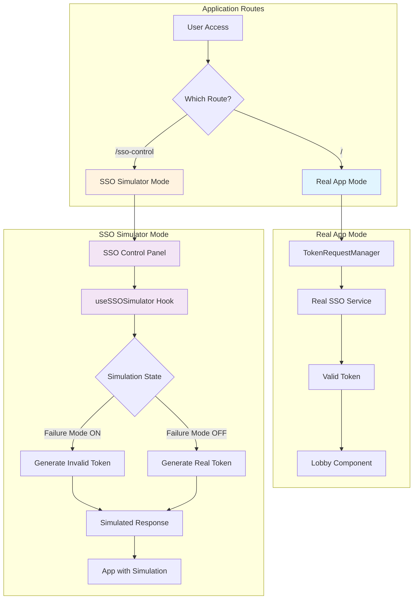

## 🔄 SSO Token Request Flow

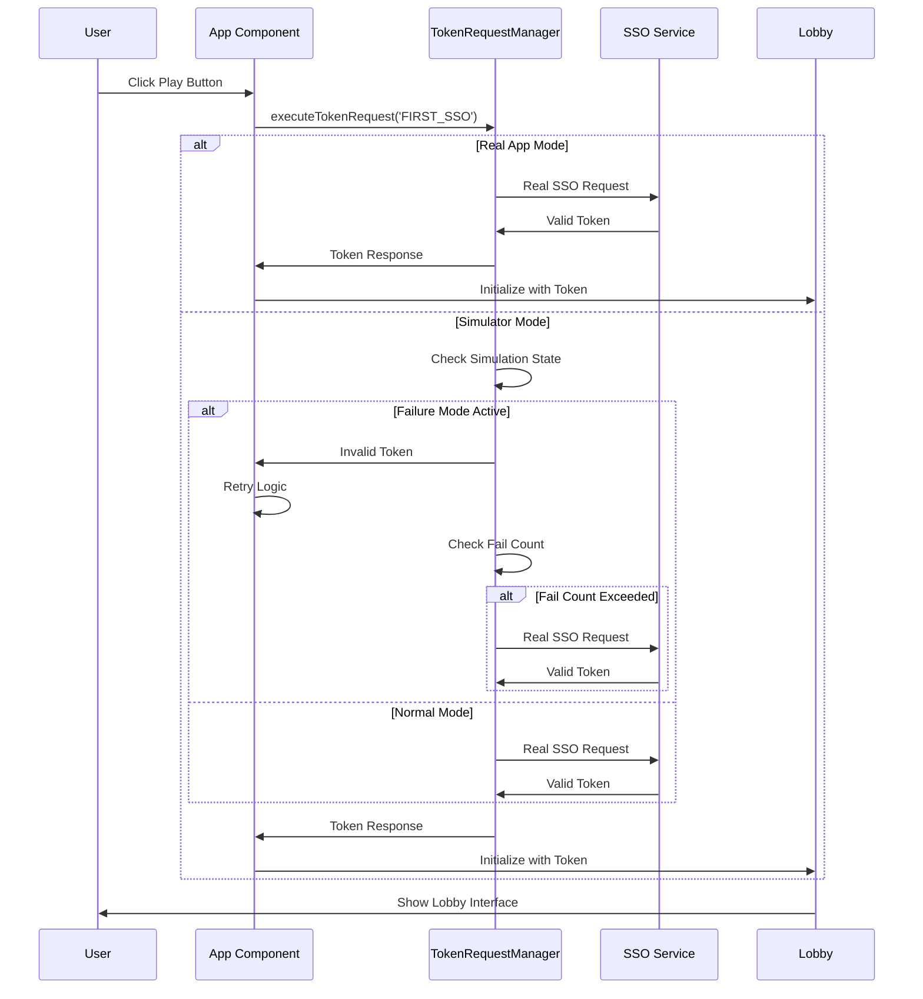

## 🎮 Simulator State Management

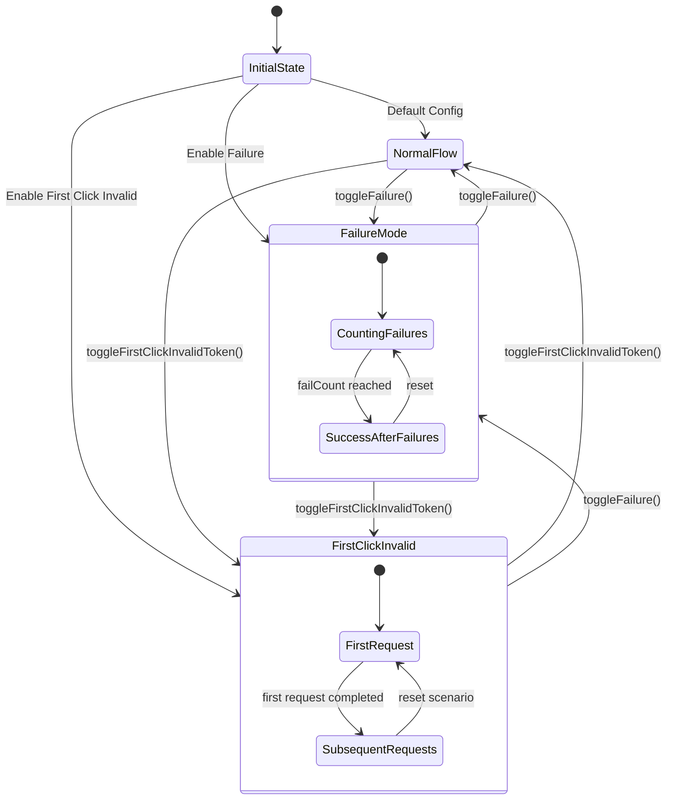

## 🎯 Scenario Configuration

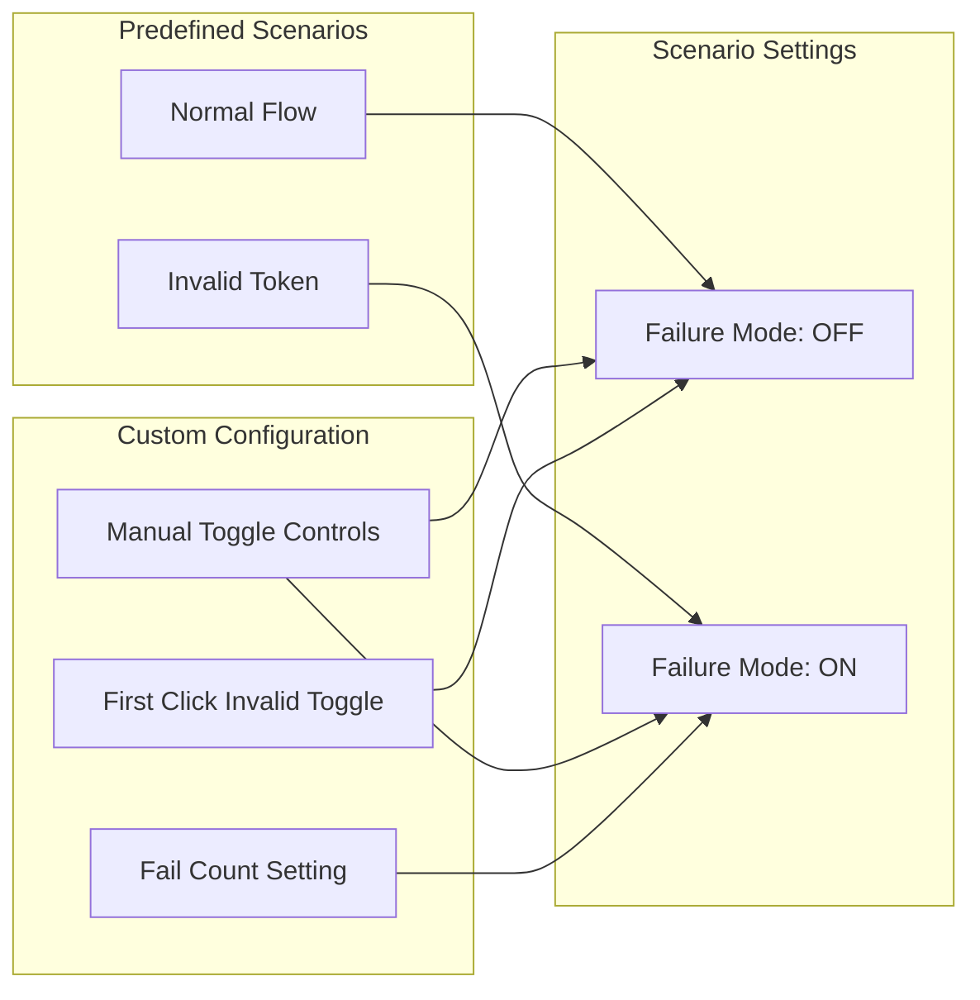

## 🔧 Control Panel Interface

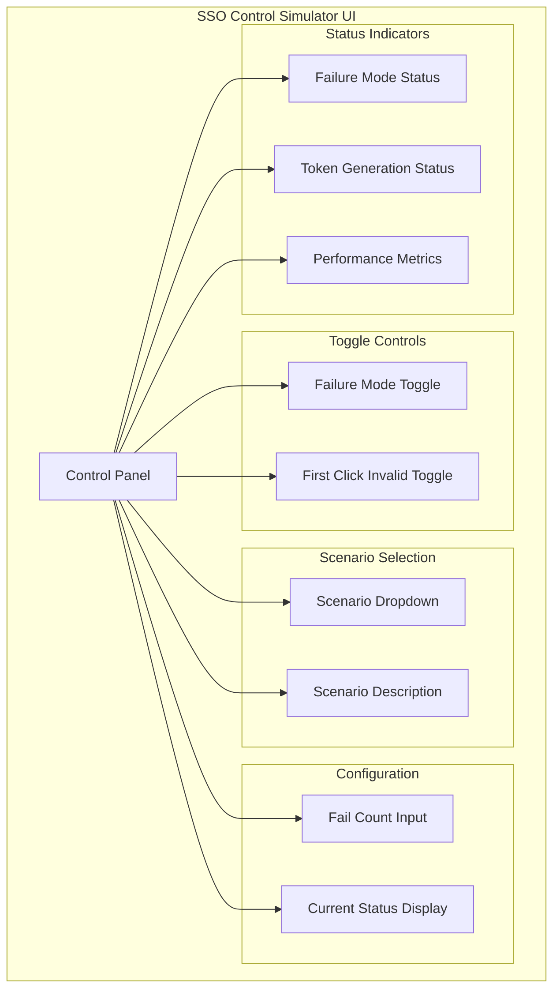

## 📈 Performance Monitoring Flow

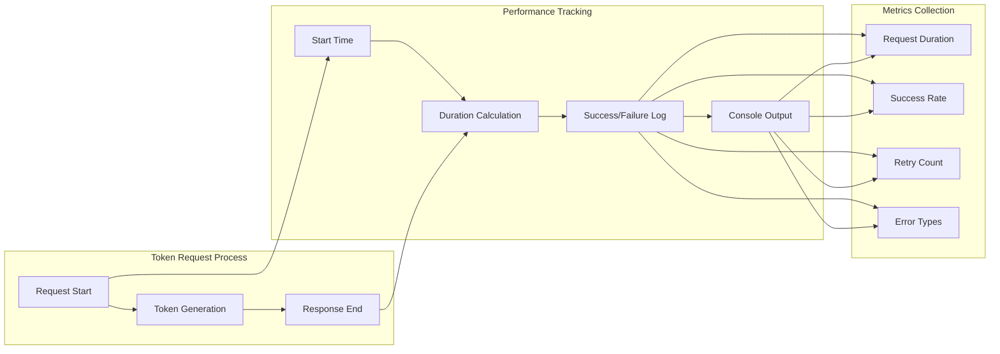

## 🛠️ Troubleshooting Decision Tree

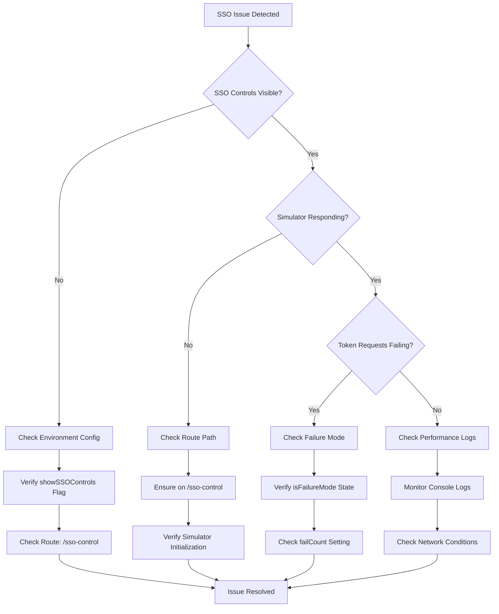

## 🔄 Session Reconnect Flow

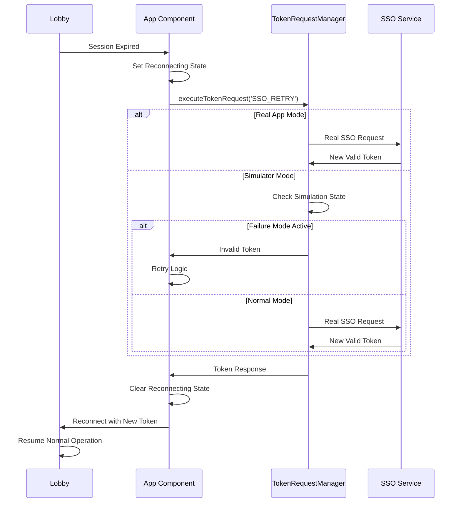

## 🎯 Testing Scenarios Matrix

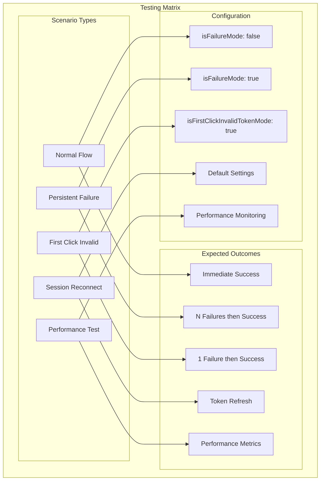

## 🚀 Quick Start Flow

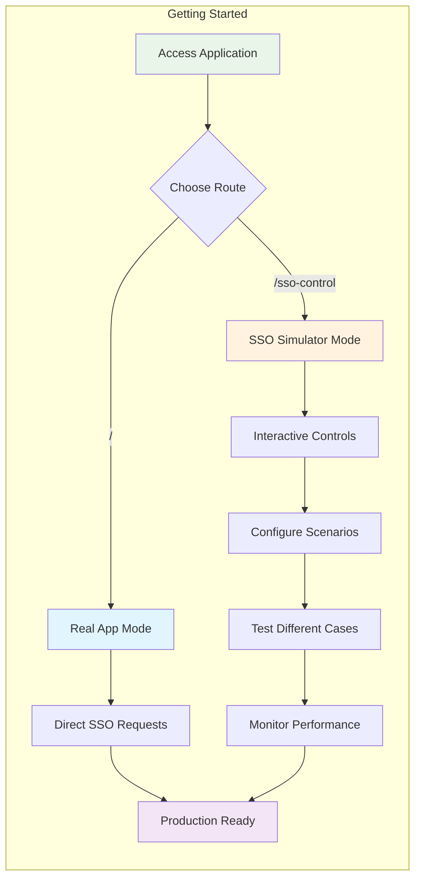

## 📊 Component Relationship Diagram

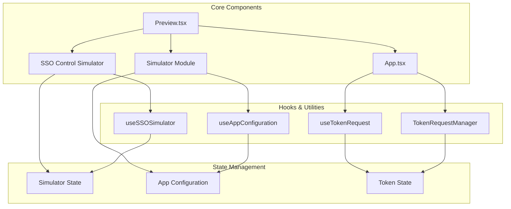

## 🎨 UI Component Hierarchy

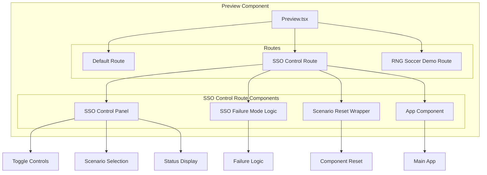

---

## 📝 Diagram Legend

### Colors

-   🔵 **Blue**: Real App Mode components
-   🟠 **Orange**: SSO Simulator Mode components
-   🟣 **Purple**: State management and hooks
-   🟢 **Green**: Success states and normal flow
-   🔴 **Red**: Error states and failure scenarios

### Shapes

-   **Rectangle**: Components and modules
-   **Diamond**: Decision points and conditions
-   **Circle**: Start/end points
-   **Parallelogram**: Input/output operations

### Arrows

-   **Solid Arrow**: Direct flow and relationships
-   **Dashed Arrow**: Optional or conditional flow
-   **Bold Arrow**: Primary flow path

---

_These diagrams provide a visual understanding of the SSO Control Simulator architecture, helping developers quickly grasp the system's structure and flow patterns._
