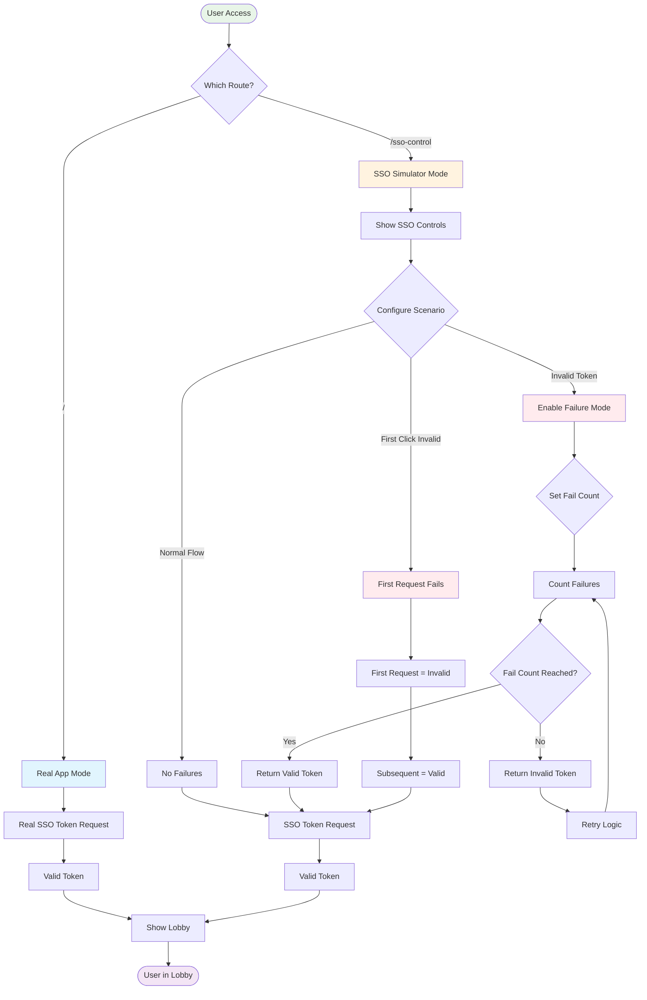
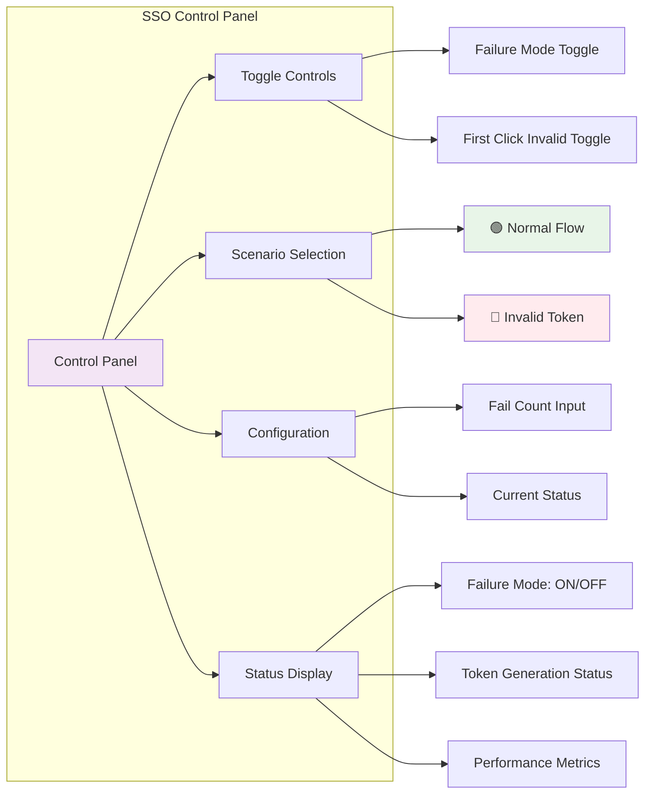
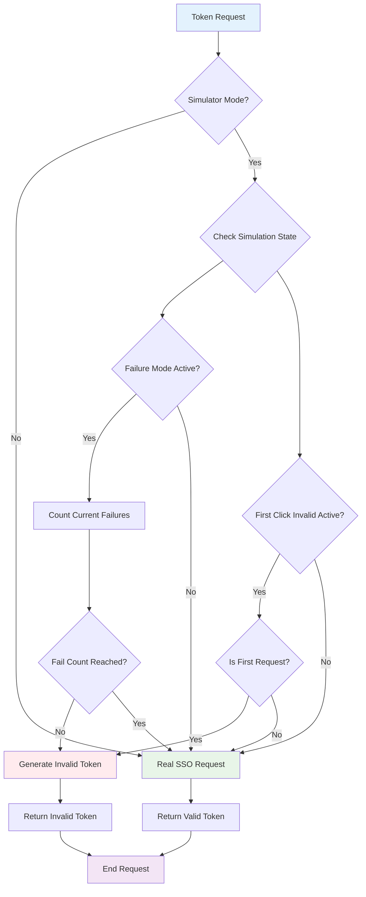
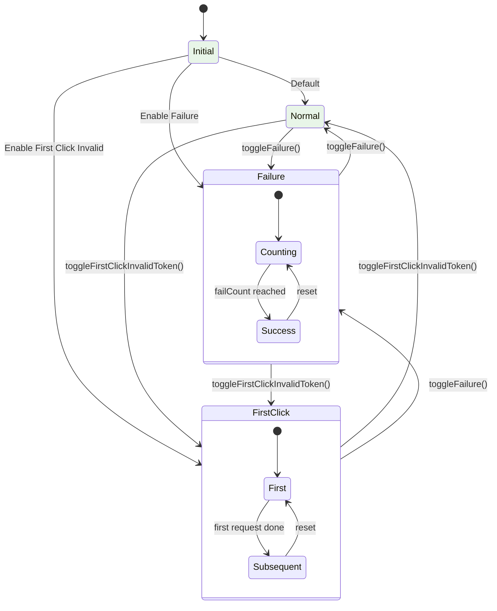
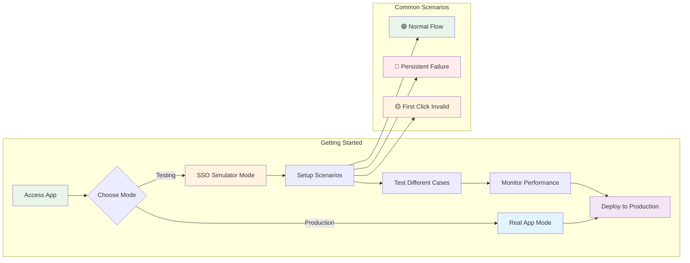
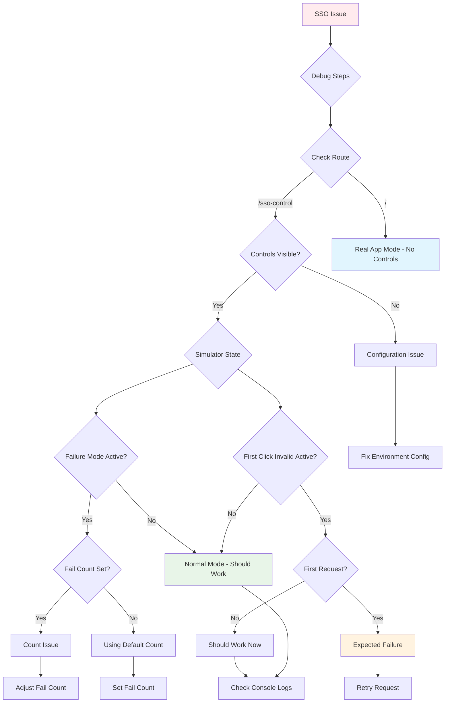
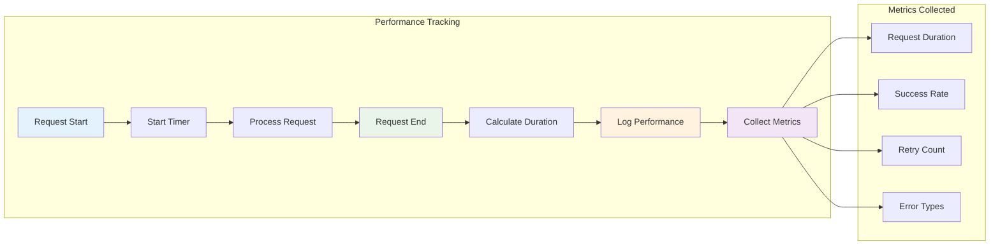

# SSO Control Simulator - Simple Flowchart

## 🎯 Main Decision Flow

## 🔧 Control Panel Flow

## 📊 Token Request Decision Tree

## 🎮 State Transitions

## 🚀 Quick Usage Guide

## 🔍 Debug Flow

## 📈 Performance Monitoring

---

## 🎯 Key Takeaways

### 🟢 **Normal Flow**

-   No simulation
-   Direct SSO requests
-   Immediate success

### 🔴 **Failure Mode**

-   Simulates persistent failures
-   Configurable fail count
-   Eventually succeeds after N failures

### 🟡 **First Click Invalid**

-   First request fails
-   Subsequent requests succeed
-   Tests retry mechanisms

### 📊 **Monitoring**

-   Performance metrics
-   Console logging
-   Success/failure tracking

---

_These simplified flowcharts provide a quick visual reference for understanding the SSO Control Simulator's key flows and decision points._
