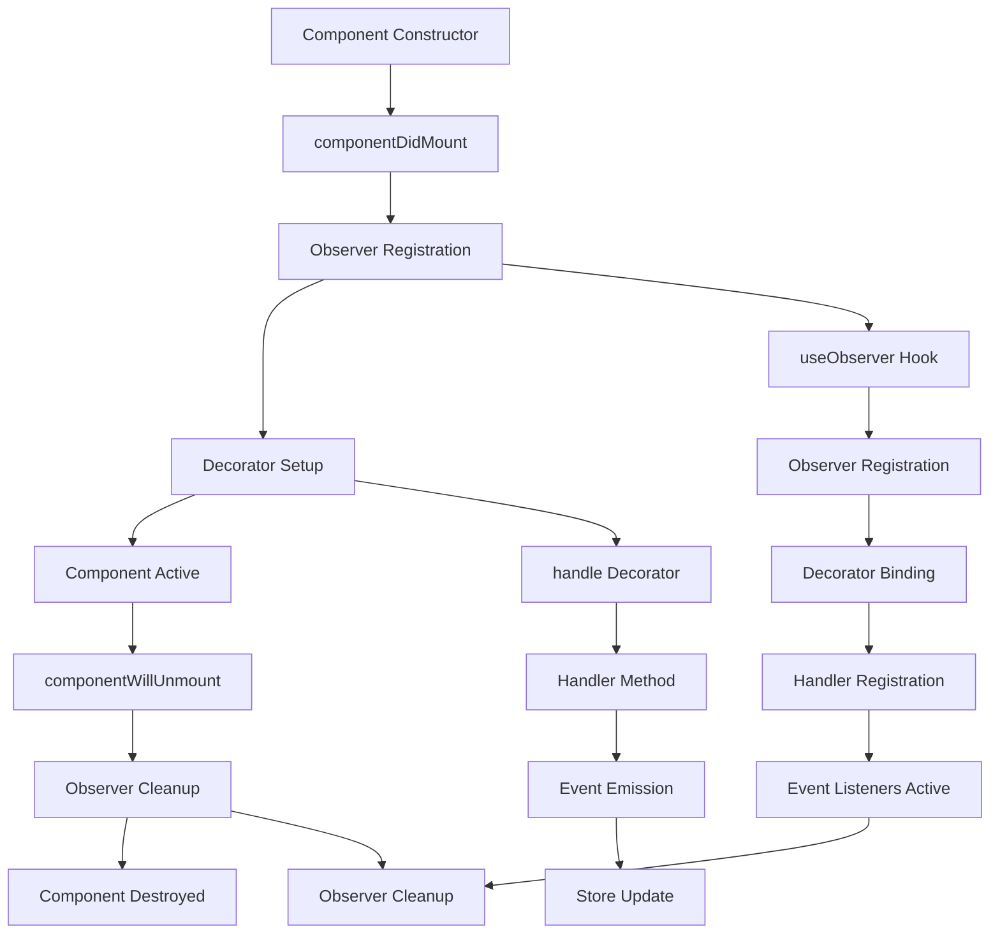
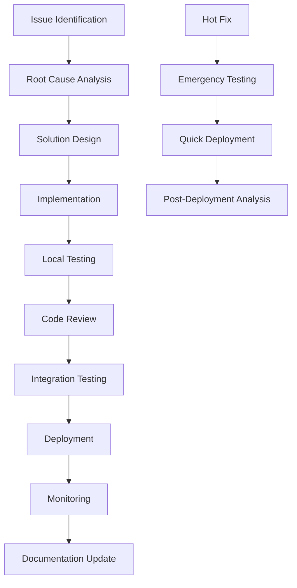

# Decorator & Observer System Lifecycle Documentation

## Table of Contents

1. [Overview](#overview)
2. [Architecture Components](#architecture-components)
3. [Component Lifecycle Flow](#component-lifecycle-flow)
4. [Decorator System](#decorator-system)
5. [Observer System](#observer-system)
6. [The Unmount Problem](#the-unmount-problem)
7. [Solutions](#solutions)
8. [Best Practices](#best-practices)
9. [Troubleshooting](#troubleshooting)
10. [Development Workflow](#development-workflow)

## Overview

This document explains the code flow lifecycle of components using decorators and observers in the `@sg/sg-game-client` and `@sg/sg-observer` systems. It specifically addresses why decorator handlers don't work during React component unmount and provides solutions.

## Architecture Components

### 1. React Component Layer

-   **GatewayGameBase**: Main game component extending GameBase
-   **ObserverComponent**: Base class providing observer functionality
-   **Lifecycle Methods**: componentDidMount, componentWillUnmount

### 2. Observer System (@sg/sg-observer)

-   **useObserver Hook**: Registers components with observer system
-   **Observer Container**: Manages component registrations and event bindings
-   **Decorator Processing**: Handles @handle and @render decorators

### 3. Dependency Injection (Inversify)

-   **Container**: Manages handler instances and dependencies
-   **Handler Registration**: Binds handlers to decorators
-   **Store Binding**: Connects stores to components

### 4. Gateway Connection System

-   **ConnectHandler**: Handles connection/disconnection logic
-   **GatewayConnectionStore**: Manages connection state
-   **Event System**: Emits connection events

## Component Lifecycle Flow



### Detailed Flow

#### 1. Component Mount Phase

```typescript
// 1. Component Constructor
class GatewayGameBase extends GameBase {
    constructor(props) {
        super(props);
        this.state = {
            isAuthorized: false,
            isSignedIn: false,
        };
    }
}

// 2. componentDidMount
componentDidMount() {
    // Observer registration happens here
    const dispose = useObserver(this, namespace);
    this.setState({ dispose });
}
```

#### 2. Observer Registration Phase

```typescript
// useObserver hook (from @sg/sg-observer)
function useObserver(component, namespace) {
    // 1. Get observer container
    const container = Observer.getContainer(namespace);

    // 2. Register component with observer
    const observer = container.register(component);

    // 3. Set up decorator bindings
    setupDecorators(component, observer);

    // 4. Return cleanup function
    return () => observer.dispose();
}
```

#### 3. Decorator Setup Phase

```typescript
// @handle decorator processing
@handle(gc.GatewayConnection.GatewayConnectionHandlers.ConnectHandler, (handler) => handler.disconnect())
terminateGatewayConnection() {
    console.log('terminate Gateway Connection');
}

// Decorator setup process:
// 1. Extract handler class from decorator
// 2. Get handler instance from DI container
// 3. Bind method call to event system
// 4. Register event listener
```

#### 4. Component Active Phase

```typescript
// During component lifecycle:
// - Decorators are active
// - Event listeners are registered
// - Handler methods can be called
// - Store updates trigger re-renders
```

#### 5. Component Unmount Phase

```typescript
// componentWillUnmount
componentWillUnmount() {
    // 1. Call parent cleanup
    super.componentWillUnmount();

    // 2. Call terminate method
    this.terminateGatewayConnection(); // ❌ DECORATOR MAY NOT WORK HERE
}

// Observer cleanup
componentWillUnmount() {
    const { dispose } = this.state;
    if (dispose) {
        dispose(); // This cleans up the observer system
    }
}
```

## Decorator System

### @handle Decorator

```typescript
@handle(gc.GatewayConnection.GatewayConnectionHandlers.ConnectHandler, (handler) => handler.disconnect())
terminateGatewayConnection() {
    console.log('terminate Gateway Connection');
}
```

**How it works:**

1. **Handler Resolution**: Gets handler instance from DI container
2. **Method Binding**: Binds the decorated method to handler method
3. **Event Registration**: Registers event listener for method calls
4. **Execution**: When method is called, handler method is executed

### @render Decorator

```typescript
@render(gc.GatewayConnection.GatewayConnectionStore, (store) => store.isConnected)
handleConnectLiveGatewayForGame(isConnected: boolean): void {
    if (isConnected) this.connectLiveGateway();
}
```

**How it works:**

1. **Store Observation**: Observes store for changes
2. **Value Extraction**: Extracts specific value from store
3. **Method Call**: Calls decorated method when value changes
4. **Re-render**: Triggers component re-render

## Observer System

### Observer Registration

```typescript
// In ObserverComponent
componentDidMount(): void {
    const { namespace } = this.props;

    if (!namespace) {
        return;
    }

    try {
        const dispose = useObserver(this, namespace);
        if (!dispose) {
            throw new Error('Observer registration failed');
        }
        this.setState({ dispose });
    } catch (error) {
        // Retry logic
    }
}
```

### Observer Cleanup

```typescript
componentWillUnmount(): void {
    const { dispose } = this.state;
    if (dispose) {
        try {
            dispose(); // Cleans up observer system
        } catch (error) {
            // Silent fail on cleanup
        }
    }
}
```

## The Unmount Problem

### Problem Description

When a React component unmounts, the decorator system becomes inactive before the component's `componentWillUnmount` method can execute decorator-bound methods.

### Root Causes

#### 1. Observer Cleanup Timing

```typescript
componentWillUnmount() {
    // 1. Observer cleanup happens first
    const { dispose } = this.state;
    if (dispose) {
        dispose(); // ❌ Observer system is now inactive
    }

    // 2. Decorator call happens after
    this.terminateGatewayConnection(); // ❌ No observer to handle this
}
```

#### 2. Event System State

```typescript
// When observer.dispose() is called:
function dispose() {
    // 1. Remove all event listeners
    this.eventListeners.clear();

    // 2. Unregister from container
    this.container.unregister(this);

    // 3. Clean up decorator bindings
    this.decoratorBindings.clear();

    // 4. Observer is now inactive
}
```

#### 3. Handler Injection Dependency

```typescript
// The handler depends on the DI container
@handle(gc.GatewayConnection.GatewayConnectionHandlers.ConnectHandler, (handler) => handler.disconnect())

// When container is cleaned up:
// - Handler instances are destroyed
// - Injection context is lost
// - Decorator can't resolve handler
```

### Symptoms

-   "GatewayConnectionHandlers disconnect" message doesn't appear
-   Connection cleanup doesn't execute properly
-   Memory leaks from uncleaned connections
-   Inconsistent behavior during component destruction

## Solutions

### Solution 1: Call Disconnect Before Observer Cleanup

```typescript
componentWillUnmount() {
    // 1. Disconnect first (while observer is active)
    this.terminateGatewayConnection();

    // 2. Then cleanup observer
    const { dispose } = this.state;
    if (dispose) {
        dispose();
    }

    // 3. Call parent cleanup
    super.componentWillUnmount();
}
```

**Pros:**

-   Simple implementation
-   Uses existing decorator system
-   Minimal code changes

**Cons:**

-   Still depends on observer timing
-   May not work in all scenarios

### Solution 2: Use Direct Handler Access

```typescript
componentWillUnmount() {
    // Direct handler access (bypasses decorator)
    const handler = sharedContainer.get(gc.GatewayConnection.GatewayConnectionHandlers.ConnectHandler);
    if (handler) {
        handler.disconnect();
    }

    // Then cleanup
    const { dispose } = this.state;
    if (dispose) {
        dispose();
    }
}
```

**Pros:**

-   Bypasses decorator system entirely
-   Guaranteed to work
-   Direct control over handler

**Cons:**

-   Bypasses intended architecture
-   Less maintainable
-   Harder to test

### Solution 3: Singleton Manager (Implemented)

```typescript
// Centralized connection management
class GatewayConnectionManager {
    private static instance: GatewayConnectionManager;

    static getInstance(): GatewayConnectionManager {
        if (!GatewayConnectionManager.instance) {
            GatewayConnectionManager.instance = new GatewayConnectionManager();
        }
        return GatewayConnectionManager.instance;
    }

    private getSharedContainer(): any {
        // Try multiple sources for the shared container
        const sources = [
            sharedContainer, // Imported from startup
            window['seal_shared_container'],
            (gc as any).sharedContainer,
            (window as any).sharedContainer
        ];

        for (const source of sources) {
            if (source && typeof source.get === 'function') {
                return source;
            }
        }
        return null;
    }

    disconnect(reason?: string): void {
        try {
            console.log(`GatewayConnectionManager: Disconnecting gateway connection${reason ? ` - ${reason}` : ''}`);

            const container = this.getSharedContainer();
            if (!container) {
                console.warn('GatewayConnectionManager: No shared container found');
                return;
            }

            const handler = container.get(gc.GatewayConnection.GatewayConnectionHandlers.ConnectHandler);
            if (handler) {
                handler.disconnect();
                console.log('GatewayConnectionManager: Disconnect called successfully');
            } else {
                console.warn('GatewayConnectionManager: ConnectHandler not found in container');
            }
        } catch (error) {
            console.error('GatewayConnectionManager: Failed to disconnect:', error);
        }
    }
}

// Usage
componentWillUnmount() {
    try {
        // 1. Use singleton manager to disconnect (independent of observer lifecycle)
        GatewayConnectionManager.getInstance().disconnect('component_unmount');
    } catch (error) {
        console.error('Failed to disconnect via GatewayConnectionManager:', error);
    }

    try {
        // 2. Then cleanup observer
        const { dispose } = this.state;
        if (dispose) {
            dispose();
        }
    } catch (error) {
        console.error('Failed to cleanup observer:', error);
    }

    // 3. Call parent cleanup
    super.componentWillUnmount();
}
```

**Pros:**

-   ✅ Centralized control
-   ✅ Independent of component lifecycle
-   ✅ Easy to use from anywhere
-   ✅ Better error handling
-   ✅ Testable
-   ✅ Robust container access with multiple fallbacks
-   ✅ Comprehensive logging for debugging

**Cons:**

-   Additional complexity
-   Requires new infrastructure

## Additional Issues Discovered

### Issue 2: Browser Tab Switching Disconnection

During our investigation, we discovered that the gateway connection was also disconnecting when users switched browser tabs, which was not the intended behavior.

#### Root Cause

The issue was in the `AppContent` component's visibility change handler:

```typescript
// ❌ Problematic code
useEffect(() => {
    const handleVisibilityChange = () => {
        if (!document.hidden) {
            // This was resetting game state every time tab became visible
            setHasClickedPlay(false);
            setCurrentToken(null);
            setIsLoading(false);
            setIsReconnecting(false);
        }
    };
    document.addEventListener('visibilitychange', handleVisibilityChange);
}, []);
```

When users switched back to the game tab, this handler would reset the game state, causing the Lobby component (containing GatewayGameBase) to unmount, which triggered the disconnect.

#### Solution

Modified the visibility change handler to preserve game sessions:

```typescript
// ✅ Fixed code
useEffect(() => {
    const handleVisibilityChange = () => {
        if (!document.hidden) {
            // Only reset game state if we're not currently in a game session
            if (!currentToken) {
                setHasClickedPlay(false);
                setCurrentToken(null);
                setIsLoading(false);
                setIsReconnecting(false);
            }
            // If we have a current token, keep the game session active
        }
    };
    document.addEventListener('visibilitychange', handleVisibilityChange);
}, [currentToken]); // Added dependency
```

### Issue 3: Socket.io Automatic Disconnection

We also discovered that socket.io has default behavior that automatically disconnects when browser tabs are not visible.

#### Solution

Added socket.io configuration options to prevent automatic disconnection:

```typescript
// In GatewayConnectionStore.initConnection()
const options = {
    ...mergedOptions,
    // Prevent automatic disconnection when tab is not visible
    autoConnect: true,
    reconnection: true,
    reconnectionAttempts: 5,
    reconnectionDelay: 1000,
    reconnectionDelayMax: 5000,
    timeout: 20000,
    // Keep connection alive even when tab is not visible
    closeOnBeforeunload: false,
} as Partial<ManagerOptions & SocketOptions>;
```

## Best Practices

### 1. Connection Management

```typescript
// ✅ Good: Use singleton manager
class ConnectionManager {
    static disconnect(reason: string) {
        // Centralized disconnect logic
    }
}

// ❌ Bad: Rely on decorators for cleanup
componentWillUnmount() {
    this.terminateGatewayConnection(); // May not work
}
```

### 2. Error Handling

```typescript
// ✅ Good: Handle cleanup errors gracefully
componentWillUnmount() {
    try {
        ConnectionManager.disconnect('unmount');
    } catch (error) {
        console.error('Cleanup failed:', error);
    }

    const { dispose } = this.state;
    if (dispose) {
        try {
            dispose();
        } catch (error) {
            console.error('Observer cleanup failed:', error);
        }
    }
}
```

### 3. Testing

```typescript
// ✅ Good: Test cleanup logic
describe('Component Cleanup', () => {
    it('should disconnect on unmount', () => {
        const disconnectSpy = jest.spyOn(ConnectionManager, 'disconnect');

        const component = mount(<MyComponent />);
        component.unmount();

        expect(disconnectSpy).toHaveBeenCalledWith('unmount');
    });
});
```

## Troubleshooting

### Common Issues

#### Issue 1: Decorator not working on unmount

**Symptoms:** No "GatewayConnectionHandlers disconnect" message
**Cause:** Observer system cleaned up before decorator execution
**Solution:** Use direct handler access or singleton manager

#### Issue 2: Connection not disconnecting

**Symptoms:** WebSocket connection remains active
**Cause:** Disconnect method not called or failed
**Solution:** Add error handling and logging

#### Issue 3: Memory leaks

**Symptoms:** Increasing memory usage
**Cause:** Observers or event listeners not cleaned up
**Solution:** Ensure dispose() is called in componentWillUnmount

### Debug Steps

1. **Add Logging**

```typescript
componentWillUnmount() {
    console.log('Component unmounting...');

    try {
        this.terminateGatewayConnection();
        console.log('Disconnect called successfully');
    } catch (error) {
        console.error('Disconnect failed:', error);
    }

    const { dispose } = this.state;
    if (dispose) {
        try {
            dispose();
            console.log('Observer cleanup successful');
        } catch (error) {
            console.error('Observer cleanup failed:', error);
        }
    }
}
```

2. **Check Observer State**

```typescript
// Add to component to check observer state
componentDidMount() {
    console.log('Observer state:', this.state.dispose ? 'Active' : 'Inactive');
}
```

3. **Verify Handler Registration**

```typescript
// Check if handler is available
const handler = sharedContainer.get(gc.GatewayConnection.GatewayConnectionHandlers.ConnectHandler);
console.log('Handler available:', !!handler);
```

### Performance Considerations

1. **Observer Cleanup**: Always call dispose() to prevent memory leaks
2. **Event Listeners**: Remove all listeners during cleanup
3. **Handler Instances**: Don't hold references to handlers after cleanup
4. **Timing**: Call disconnect methods before observer cleanup

## Case Study: Gateway Connection Cleanup

### Problem Description

The `GatewayGameBase` component was experiencing connection cleanup issues:

1. **Decorator not working on unmount**: The `@handle` decorator wasn't executing during `componentWillUnmount`
2. **Tab switching disconnection**: Connections were disconnecting when users switched browser tabs
3. **Socket.io automatic disconnection**: Default socket.io behavior was causing unwanted disconnections

### Investigation Process

#### Step 1: Identify the Core Issue

-   Analyzed the component lifecycle flow
-   Discovered that observer cleanup happens before decorator execution
-   Confirmed that `@handle` decorators become inactive during unmount

#### Step 2: Implement Singleton Manager

-   Created `GatewayConnectionManager` with robust container access
-   Added multiple fallback sources for container access
-   Implemented comprehensive error handling and logging

#### Step 3: Discover Additional Issues

-   Found that visibility change handlers were causing component unmount
-   Identified socket.io default behavior causing automatic disconnections
-   Root cause analysis revealed multiple layers of issues

#### Step 4: Implement Comprehensive Solution

-   Fixed visibility change handler to preserve game sessions
-   Added socket.io configuration to prevent automatic disconnection
-   Enhanced singleton manager with better debugging capabilities

### Final Implementation

#### 1. GatewayConnectionManager

```typescript
// File: seal-monorepo/libs/hot-league-wall/src/games/game-base/gateway/gateway-connection-manager.ts
export class GatewayConnectionManager {
    private static instance: GatewayConnectionManager;

    static getInstance(): GatewayConnectionManager {
        if (!GatewayConnectionManager.instance) {
            GatewayConnectionManager.instance = new GatewayConnectionManager();
        }
        return GatewayConnectionManager.instance;
    }

    disconnect(reason?: string): void {
        // Robust container access with multiple fallbacks
        // Comprehensive error handling and logging
        // Direct handler access bypassing decorator system
    }
}
```

#### 2. Updated Component Lifecycle

```typescript
// File: seal-monorepo/libs/hot-league-wall/src/games/game-base/gateway/gateway-game-base.tsx
componentWillUnmount() {
    try {
        // 1. Use singleton manager to disconnect (independent of observer lifecycle)
        GatewayConnectionManager.getInstance().disconnect('component_unmount');
    } catch (error) {
        console.error('Failed to disconnect via GatewayConnectionManager:', error);
    }

    try {
        // 2. Then cleanup observer
        const { dispose } = this.state;
        if (dispose) {
            dispose();
        }
    } catch (error) {
        console.error('Failed to cleanup observer:', error);
    }

    // 3. Call parent cleanup
    super.componentWillUnmount();
}
```

#### 3. Fixed Visibility Change Handler

```typescript
// File: seal-monorepo/libs/hot-league-wall/src/app.tsx
useEffect(() => {
    const handleVisibilityChange = () => {
        if (!document.hidden) {
            // Only reset game state if we're not currently in a game session
            if (!currentToken) {
                setHasClickedPlay(false);
                setCurrentToken(null);
                setIsLoading(false);
                setIsReconnecting(false);
            }
            // If we have a current token, keep the game session active
        }
    };
    document.addEventListener('visibilitychange', handleVisibilityChange);
}, [currentToken]);
```

#### 4. Enhanced Socket.io Configuration

```typescript
// File: sg-game-client/src/gateway-connection/gateway-connection-store.ts
const options = {
    ...mergedOptions,
    // Prevent automatic disconnection when tab is not visible
    autoConnect: true,
    reconnection: true,
    reconnectionAttempts: 5,
    reconnectionDelay: 1000,
    reconnectionDelayMax: 5000,
    timeout: 20000,
    closeOnBeforeunload: false,
} as Partial<ManagerOptions & SocketOptions>;
```

### Results

✅ **Decorator issue resolved**: Singleton manager bypasses decorator system entirely
✅ **Tab switching fixed**: Game sessions preserved when switching tabs
✅ **Socket.io behavior controlled**: No automatic disconnection on tab switch
✅ **Robust error handling**: Comprehensive logging and fallback mechanisms
✅ **Maintainable solution**: Centralized connection management

### Lessons Learned

1. **Multiple root causes**: The original issue had multiple contributing factors
2. **Investigation depth**: Thorough investigation revealed unexpected issues
3. **Defensive programming**: Multiple fallbacks and error handling are essential
4. **Browser behavior**: Understanding browser and socket.io default behaviors is crucial
5. **Component lifecycle**: React component lifecycle can be affected by parent components

## Conclusion

The decorator and observer system provides powerful functionality for reactive components, but has limitations during component unmount. The recommended solution is to use a singleton manager for connection management, ensuring reliable cleanup independent of the component lifecycle.

Key takeaways:

-   Observer cleanup happens before decorator execution
-   Use singleton managers for critical cleanup operations
-   Always handle cleanup errors gracefully
-   Test cleanup logic thoroughly
-   Monitor for memory leaks
-   **Investigate multiple potential root causes**
-   **Consider browser and library default behaviors**
-   **Implement defensive programming with multiple fallbacks**

This approach ensures reliable connection management while maintaining the benefits of the decorator system during component lifecycle.

## Development Workflow

This section provides a comprehensive workflow for developing, testing, and deploying changes to the decorator and observer system.

### Workflow Overview



### Phase 1: Issue Identification & Analysis

#### Step 1: Problem Documentation

**Template for Issue Documentation:**

```markdown
## Issue Description

-   **Component**: [Component Name]
-   **Environment**: [Development/Staging/Production]
-   **Frequency**: [Always/Sometimes/Rarely]
-   **Impact**: [High/Medium/Low]

## Symptoms

-   [ ] Specific error messages
-   [ ] Behavioral changes
-   [ ] Performance degradation
-   [ ] Memory leaks

## Steps to Reproduce

1. [Step 1]
2. [Step 2]
3. [Step 3]

## Expected vs Actual Behavior

-   **Expected**: [Description]
-   **Actual**: [Description]

## Environment Details

-   Browser: [Version]
-   OS: [Version]
-   Game Client: [Version]
-   Network: [Type]
```

#### Step 2: Root Cause Analysis

**Investigation Checklist:**

```typescript
// 1. Component Lifecycle Analysis
const lifecycleChecklist = {
    mountPhase: {
        constructor: 'Component initialization',
        componentDidMount: 'Observer registration',
        decoratorSetup: 'Handler binding',
    },
    activePhase: {
        decoratorExecution: 'Event handling',
        storeUpdates: 'State management',
        reRenders: 'UI updates',
    },
    unmountPhase: {
        componentWillUnmount: 'Cleanup execution',
        observerDisposal: 'System cleanup',
        handlerDestruction: 'Resource cleanup',
    },
};

// 2. Observer System Analysis
const observerAnalysis = {
    registration: 'Check observer container state',
    eventListeners: 'Verify event binding',
    decoratorBindings: 'Confirm handler connections',
    cleanup: 'Validate disposal process',
};

// 3. Dependency Injection Analysis
const diAnalysis = {
    containerState: 'Check container availability',
    handlerRegistration: 'Verify handler binding',
    injectionContext: 'Confirm dependency resolution',
};
```

#### Step 3: Impact Assessment

**Risk Matrix:**

| Impact | Probability | Risk Level | Action Required |
| ------ | ----------- | ---------- | --------------- |
| High   | High        | Critical   | Immediate fix   |
| High   | Medium      | High       | Priority fix    |
| Medium | High        | High       | Priority fix    |
| Medium | Medium      | Medium     | Scheduled fix   |
| Low    | High        | Medium     | Scheduled fix   |
| Low    | Low         | Low        | Monitor         |

### Phase 2: Solution Design

#### Step 1: Solution Architecture

**Design Template:**

```typescript
// Solution Architecture Document
interface SolutionDesign {
    problem: {
        description: string;
        rootCauses: string[];
        impact: 'High' | 'Medium' | 'Low';
    };

    solution: {
        approach: 'Singleton Manager' | 'Direct Access' | 'Lifecycle Modification';
        components: string[];
        dependencies: string[];
        risks: string[];
    };

    implementation: {
        files: string[];
        changes: string[];
        testing: string[];
        rollback: string[];
    };

    validation: {
        successCriteria: string[];
        testCases: string[];
        performanceImpact: string;
    };
}
```

#### Step 2: Code Review Checklist

**Pre-Implementation Review:**

-   [ ] **Architecture Alignment**

    -   [ ] Follows existing patterns
    -   [ ] Maintains separation of concerns
    -   [ ] Preserves dependency injection principles

-   [ ] **Error Handling**

    -   [ ] Comprehensive try-catch blocks
    -   [ ] Graceful degradation
    -   [ ] Meaningful error messages

-   [ ] **Performance Considerations**

    -   [ ] Memory leak prevention
    -   [ ] Efficient resource usage
    -   [ ] Minimal performance impact

-   [ ] **Testing Strategy**
    -   [ ] Unit test coverage
    -   [ ] Integration test scenarios
    -   [ ] Edge case handling

#### Step 3: Implementation Planning

**Implementation Steps:**

```typescript
// Implementation Plan
const implementationPlan = {
    phase1: {
        name: 'Core Implementation',
        tasks: [
            'Create singleton manager class',
            'Implement robust container access',
            'Add comprehensive error handling',
            'Include detailed logging',
        ],
        estimatedTime: '4-6 hours',
        dependencies: ['TypeScript', 'Inversify', 'Logging system'],
    },

    phase2: {
        name: 'Integration',
        tasks: [
            'Update component lifecycle',
            'Modify visibility change handlers',
            'Configure socket.io options',
            'Update dependency injection',
        ],
        estimatedTime: '2-3 hours',
        dependencies: ['Phase 1 completion', 'React components', 'Socket.io'],
    },

    phase3: {
        name: 'Testing & Validation',
        tasks: ['Write unit tests', 'Perform integration testing', 'Conduct performance testing', 'Validate error scenarios'],
        estimatedTime: '3-4 hours',
        dependencies: ['Phase 2 completion', 'Jest', 'Testing utilities'],
    },
};
```

### Phase 3: Implementation

#### Step 1: Development Environment Setup

**Environment Configuration:**

```bash
# 1. Clone and setup repository
git clone <repository-url>
cd seal-monorepo
npm install

# 2. Setup development environment
npm run setup:dev

# 3. Start development servers
npm run dev:hot-league-wall
npm run dev:saba-games

# 4. Verify environment
npm run test:unit
npm run lint
```

#### Step 2: Code Implementation

**Implementation Guidelines:**

```typescript
// 1. File Structure
const fileStructure = {
    manager: 'src/games/game-base/gateway/gateway-connection-manager.ts',
    component: 'src/games/game-base/gateway/gateway-game-base.tsx',
    store: 'src/gateway-connection/gateway-connection-store.ts',
    app: 'src/app.tsx',
};

// 2. Coding Standards
const codingStandards = {
    naming: 'PascalCase for classes, camelCase for methods',
    imports: 'Grouped and ordered imports',
    comments: 'JSDoc for public methods',
    errorHandling: 'Try-catch with meaningful messages',
    logging: 'Consistent log levels and formats',
};

// 3. TypeScript Configuration
const tsConfig = {
    strict: true,
    noImplicitAny: true,
    strictNullChecks: true,
    noUnusedLocals: true,
    noUnusedParameters: true,
};
```

#### Step 3: Testing Implementation

**Testing Strategy:**

```typescript
// 1. Unit Tests
describe('GatewayConnectionManager', () => {
    beforeEach(() => {
        // Setup test environment
        jest.clearAllMocks();
        // Mock container and handlers
    });

    describe('getInstance', () => {
        it('should return singleton instance', () => {
            const instance1 = GatewayConnectionManager.getInstance();
            const instance2 = GatewayConnectionManager.getInstance();
            expect(instance1).toBe(instance2);
        });
    });

    describe('disconnect', () => {
        it('should disconnect successfully with valid container', () => {
            // Arrange
            const mockHandler = { disconnect: jest.fn() };
            const mockContainer = { get: jest.fn().mockReturnValue(mockHandler) };

            // Act
            GatewayConnectionManager.getInstance().disconnect('test');

            // Assert
            expect(mockHandler.disconnect).toHaveBeenCalled();
        });

        it('should handle missing container gracefully', () => {
            // Arrange
            const consoleSpy = jest.spyOn(console, 'warn');

            // Act
            GatewayConnectionManager.getInstance().disconnect('test');

            // Assert
            expect(consoleSpy).toHaveBeenCalledWith(
                'GatewayConnectionManager: No shared container found'
            );
        });

        it('should handle missing handler gracefully', () => {
            // Arrange
            const mockContainer = { get: jest.fn().mockReturnValue(null) };
            const consoleSpy = jest.spyOn(console, 'warn');

            // Act
            GatewayConnectionManager.getInstance().disconnect('test');

            // Assert
            expect(consoleSpy).toHaveBeenCalledWith(
                'GatewayConnectionManager: ConnectHandler not found in container'
            );
        });
    });
});

// 2. Integration Tests
describe('Component Lifecycle Integration', () => {
    it('should disconnect on component unmount', () => {
        // Arrange
        const disconnectSpy = jest.spyOn(
            GatewayConnectionManager.getInstance(),
            'disconnect'
        );

        // Act
        const component = mount(<GatewayGameBase />);
        component.unmount();

        // Assert
        expect(disconnectSpy).toHaveBeenCalledWith('component_unmount');
    });
});

// 3. Performance Tests
describe('Performance Tests', () => {
    it('should not cause memory leaks', () => {
        // Arrange
        const initialMemory = performance.memory?.usedJSHeapSize || 0;

        // Act
        for (let i = 0; i < 100; i++) {
            const component = mount(<GatewayGameBase />);
            component.unmount();
        }

        // Assert
        const finalMemory = performance.memory?.usedJSHeapSize || 0;
        const memoryIncrease = finalMemory - initialMemory;
        expect(memoryIncrease).toBeLessThan(1024 * 1024); // Less than 1MB
    });
});
```

### Phase 4: Testing & Validation

#### Step 1: Local Testing

**Testing Checklist:**

```typescript
// Local Testing Checklist
const localTestingChecklist = {
    unitTests: {
        status: 'Pass/Fail',
        coverage: 'Percentage',
        criticalPaths: 'Verified',
    },

    integrationTests: {
        componentLifecycle: 'Verified',
        observerSystem: 'Tested',
        decoratorSystem: 'Validated',
    },

    manualTesting: {
        componentMount: 'Tested',
        componentUnmount: 'Verified',
        tabSwitching: 'Validated',
        errorScenarios: 'Handled',
    },

    performanceTesting: {
        memoryUsage: 'Monitored',
        responseTime: 'Measured',
        resourceCleanup: 'Verified',
    },
};
```

#### Step 2: Automated Testing

**CI/CD Pipeline Configuration:**

```yaml
# .github/workflows/test.yml
name: Test Suite

on: [push, pull_request]

jobs:
    test:
        runs-on: ubuntu-latest

        steps:
            - uses: actions/checkout@v3

            - name: Setup Node.js
              uses: actions/setup-node@v3
              with:
                  node-version: '18'
                  cache: 'npm'

            - name: Install dependencies
              run: npm ci

            - name: Run linting
              run: npm run lint

            - name: Run unit tests
              run: npm run test:unit

            - name: Run integration tests
              run: npm run test:integration

            - name: Generate coverage report
              run: npm run test:coverage

            - name: Upload coverage
              uses: codecov/codecov-action@v3
```

#### Step 3: Performance Testing

**Performance Test Suite:**

```typescript
// Performance Test Configuration
const performanceTests = {
    memoryLeakTest: {
        description: 'Verify no memory leaks during component lifecycle',
        iterations: 1000,
        threshold: '1MB increase',
        metrics: ['heapSize', 'eventListeners', 'observers'],
    },

    responseTimeTest: {
        description: 'Measure disconnect operation performance',
        iterations: 100,
        threshold: '100ms average',
        metrics: ['disconnectTime', 'cleanupTime'],
    },

    stressTest: {
        description: 'Test under high load conditions',
        concurrentComponents: 50,
        duration: '5 minutes',
        metrics: ['memoryUsage', 'cpuUsage', 'errorRate'],
    },
};

// Performance Monitoring
class PerformanceMonitor {
    private metrics: Map<string, number[]> = new Map();

    startTimer(operation: string): () => void {
        const startTime = performance.now();
        return () => {
            const duration = performance.now() - startTime;
            if (!this.metrics.has(operation)) {
                this.metrics.set(operation, []);
            }
            this.metrics.get(operation)!.push(duration);
        };
    }

    getAverageTime(operation: string): number {
        const times = this.metrics.get(operation) || [];
        return times.reduce((sum, time) => sum + time, 0) / times.length;
    }

    generateReport(): string {
        const report = ['Performance Report:'];
        for (const [operation, times] of this.metrics) {
            const avg = this.getAverageTime(operation);
            const min = Math.min(...times);
            const max = Math.max(...times);
            report.push(`${operation}: avg=${avg.toFixed(2)}ms, min=${min.toFixed(2)}ms, max=${max.toFixed(2)}ms`);
        }
        return report.join('\n');
    }
}
```

### Phase 5: Code Review & Approval

#### Step 1: Pull Request Process

**PR Template:**

```markdown
## Pull Request: [Title]

### Description

Brief description of the changes and why they were made.

### Type of Change

-   [ ] Bug fix
-   [ ] New feature
-   [ ] Breaking change
-   [ ] Documentation update

### Testing

-   [ ] Unit tests added/updated
-   [ ] Integration tests added/updated
-   [ ] Manual testing completed
-   [ ] Performance testing completed

### Checklist

-   [ ] Code follows project standards
-   [ ] Self-review completed
-   [ ] Documentation updated
-   [ ] No breaking changes (or documented)
-   [ ] Error handling implemented
-   [ ] Logging added where appropriate

### Related Issues

Closes #[issue-number]

### Screenshots (if applicable)

[Add screenshots here]

### Additional Notes

[Any additional information]
```

#### Step 2: Review Guidelines

**Review Checklist:**

```typescript
// Code Review Checklist
const reviewChecklist = {
    functionality: {
        requirementsMet: 'All requirements implemented',
        edgeCasesHandled: 'Edge cases considered',
        errorScenarios: 'Error handling implemented',
    },

    codeQuality: {
        readability: 'Code is clear and well-documented',
        maintainability: 'Code is maintainable',
        performance: 'No performance issues introduced',
    },

    testing: {
        coverage: 'Adequate test coverage',
        testQuality: 'Tests are meaningful',
        edgeCaseTesting: 'Edge cases tested',
    },

    security: {
        inputValidation: 'Inputs are validated',
        errorExposure: 'No sensitive data in errors',
        resourceCleanup: 'Resources are properly cleaned up',
    },
};
```

### Phase 6: Deployment

#### Step 1: Pre-Deployment Checklist

**Deployment Preparation:**

```typescript
// Pre-Deployment Checklist
const preDeploymentChecklist = {
    codeReview: {
        status: 'Approved',
        reviewers: ['Reviewer 1', 'Reviewer 2'],
        comments: 'All comments addressed',
    },

    testing: {
        unitTests: 'All passing',
        integrationTests: 'All passing',
        performanceTests: 'Within thresholds',
        manualTesting: 'Completed',
    },

    documentation: {
        codeComments: 'Updated',
        apiDocumentation: 'Updated',
        changelog: 'Updated',
    },

    deployment: {
        environment: 'Staging/Production',
        rollbackPlan: 'Prepared',
        monitoring: 'Configured',
    },
};
```

#### Step 2: Deployment Process

**Deployment Steps:**

```bash
# 1. Pre-deployment validation
npm run test:all
npm run build
npm run lint

# 2. Create deployment branch
git checkout -b deploy/feature-name
git push origin deploy/feature-name

# 3. Deploy to staging
npm run deploy:staging

# 4. Validate staging deployment
npm run test:staging
npm run health:check

# 5. Deploy to production
npm run deploy:production

# 6. Post-deployment validation
npm run test:production
npm run health:check
npm run monitor:performance
```

#### Step 3: Monitoring & Rollback

**Monitoring Configuration:**

```typescript
// Monitoring Setup
class DeploymentMonitor {
    private metrics: Map<string, any> = new Map();
    private alerts: Alert[] = [];

    startMonitoring(): void {
        // Monitor key metrics
        this.monitorErrorRate();
        this.monitorPerformance();
        this.monitorMemoryUsage();
        this.monitorConnectionStatus();
    }

    private monitorErrorRate(): void {
        // Monitor error rates and alert if threshold exceeded
        const errorThreshold = 0.05; // 5%
        // Implementation details...
    }

    private monitorPerformance(): void {
        // Monitor response times and performance metrics
        const performanceThreshold = 1000; // 1 second
        // Implementation details...
    }

    private monitorMemoryUsage(): void {
        // Monitor memory usage for potential leaks
        const memoryThreshold = 100 * 1024 * 1024; // 100MB
        // Implementation details...
    }

    private monitorConnectionStatus(): void {
        // Monitor gateway connection status
        // Implementation details...
    }

    triggerRollback(): void {
        console.log('Rollback triggered due to critical issues');
        // Implement rollback logic
    }
}

// Rollback Plan
const rollbackPlan = {
    triggers: {
        errorRate: 'Error rate > 5% for 5 minutes',
        performance: 'Response time > 2 seconds average',
        memoryLeak: 'Memory usage > 200MB',
        connectionIssues: 'Connection failures > 10%',
    },

    actions: {
        immediate: 'Rollback to previous version',
        investigation: 'Analyze logs and metrics',
        fix: 'Implement hotfix if needed',
        redeploy: 'Deploy fixed version',
    },

    communication: {
        stakeholders: 'Notify relevant teams',
        users: 'Update status page',
        documentation: 'Update incident report',
    },
};
```

### Phase 7: Post-Deployment

#### Step 1: Monitoring & Validation

**Post-Deployment Monitoring:**

```typescript
// Post-Deployment Monitoring
class PostDeploymentMonitor {
    private deploymentTime: Date;
    private metrics: DeploymentMetrics;

    constructor() {
        this.deploymentTime = new Date();
        this.metrics = new DeploymentMetrics();
    }

    startMonitoring(): void {
        // Monitor for 24 hours post-deployment
        const monitoringDuration = 24 * 60 * 60 * 1000; // 24 hours

        setTimeout(() => {
            this.generatePostDeploymentReport();
        }, monitoringDuration);

        // Continuous monitoring
        setInterval(() => {
            this.collectMetrics();
            this.checkAlerts();
        }, 60000); // Every minute
    }

    private collectMetrics(): void {
        // Collect various metrics
        this.metrics.collectErrorRate();
        this.metrics.collectPerformanceMetrics();
        this.metrics.collectMemoryUsage();
        this.metrics.collectConnectionMetrics();
    }

    private checkAlerts(): void {
        // Check for alert conditions
        if (this.metrics.errorRate > 0.05) {
            this.triggerAlert('High error rate detected');
        }

        if (this.metrics.averageResponseTime > 1000) {
            this.triggerAlert('Performance degradation detected');
        }

        if (this.metrics.memoryUsage > 200 * 1024 * 1024) {
            this.triggerAlert('Memory usage exceeded threshold');
        }
    }

    private generatePostDeploymentReport(): void {
        const report = {
            deploymentTime: this.deploymentTime,
            monitoringDuration: '24 hours',
            metrics: this.metrics.getSummary(),
            issues: this.metrics.getIssues(),
            recommendations: this.generateRecommendations(),
        };

        console.log('Post-Deployment Report:', report);
        // Send report to stakeholders
    }

    private generateRecommendations(): string[] {
        const recommendations: string[] = [];

        if (this.metrics.errorRate > 0.01) {
            recommendations.push('Investigate error patterns and implement fixes');
        }

        if (this.metrics.averageResponseTime > 500) {
            recommendations.push('Optimize performance bottlenecks');
        }

        if (this.metrics.memoryUsage > 100 * 1024 * 1024) {
            recommendations.push('Investigate potential memory leaks');
        }

        return recommendations;
    }
}
```

#### Step 2: Documentation Update

**Documentation Update Process:**

```typescript
// Documentation Update Checklist
const documentationUpdateChecklist = {
    technicalDocumentation: {
        apiChanges: 'Updated API documentation',
        architectureChanges: 'Updated architecture diagrams',
        codeComments: 'Updated inline documentation',
    },

    userDocumentation: {
        featureUpdates: 'Updated user guides',
        changelog: 'Updated changelog',
        releaseNotes: 'Created release notes',
    },

    operationalDocumentation: {
        deploymentProcedures: 'Updated deployment guides',
        troubleshooting: 'Updated troubleshooting guides',
        monitoring: 'Updated monitoring documentation',
    },
};

// Documentation Templates
const documentationTemplates = {
    changelog: `
## [Version] - [Date]

### Added
- New features and enhancements

### Changed
- Changes to existing functionality

### Fixed
- Bug fixes and improvements

### Removed
- Deprecated features removed
    `,

    releaseNotes: `
## Release Notes - [Version]

### Overview
Brief description of the release

### Key Features
- Feature 1: Description
- Feature 2: Description

### Breaking Changes
- Breaking change 1: Migration guide
- Breaking change 2: Migration guide

### Bug Fixes
- Bug fix 1: Description
- Bug fix 2: Description

### Performance Improvements
- Performance improvement 1: Description
- Performance improvement 2: Description
    `,

    troubleshootingGuide: `
## Troubleshooting Guide

### Common Issues

#### Issue 1: [Description]
**Symptoms:** [List symptoms]
**Cause:** [Root cause]
**Solution:** [Step-by-step solution]

#### Issue 2: [Description]
**Symptoms:** [List symptoms]
**Cause:** [Root cause]
**Solution:** [Step-by-step solution]

### Debug Tools
- [Debug tool 1]: [Usage instructions]
- [Debug tool 2]: [Usage instructions]

### Support Contacts
- [Contact information]
    `,
};
```

### Phase 8: Maintenance & Iteration

#### Step 1: Ongoing Maintenance

**Maintenance Schedule:**

```typescript
// Maintenance Schedule
const maintenanceSchedule = {
    daily: {
        monitoring: 'Review error logs and performance metrics',
        alerts: 'Check for any active alerts',
        health: 'Verify system health status',
    },

    weekly: {
        performance: 'Review performance trends',
        errors: 'Analyze error patterns',
        updates: 'Plan for upcoming updates',
    },

    monthly: {
        optimization: 'Identify optimization opportunities',
        documentation: 'Review and update documentation',
        training: 'Team training and knowledge sharing',
    },

    quarterly: {
        architecture: 'Review architecture decisions',
        security: 'Security audit and updates',
        roadmap: 'Update development roadmap',
    },
};

// Maintenance Tasks
class MaintenanceManager {
    private tasks: MaintenanceTask[] = [];

    scheduleTask(task: MaintenanceTask): void {
        this.tasks.push(task);
        this.prioritizeTasks();
    }

    private prioritizeTasks(): void {
        this.tasks.sort((a, b) => {
            if (a.priority === 'Critical' && b.priority !== 'Critical') return -1;
            if (b.priority === 'Critical' && a.priority !== 'Critical') return 1;
            return a.dueDate.getTime() - b.dueDate.getTime();
        });
    }

    executeTasks(): void {
        const dueTasks = this.tasks.filter((task) => task.dueDate <= new Date() && task.status === 'Pending');

        dueTasks.forEach((task) => {
            try {
                task.execute();
                task.status = 'Completed';
            } catch (error) {
                task.status = 'Failed';
                console.error(`Task ${task.name} failed:`, error);
            }
        });
    }
}
```

#### Step 2: Continuous Improvement

**Improvement Process:**

```typescript
// Continuous Improvement Framework
class ImprovementFramework {
    private feedback: Feedback[] = [];
    private metrics: ImprovementMetrics;

    collectFeedback(): void {
        // Collect feedback from various sources
        this.collectUserFeedback();
        this.collectDeveloperFeedback();
        this.collectOperationalFeedback();
    }

    analyzeMetrics(): void {
        // Analyze performance and usage metrics
        this.metrics.analyzePerformance();
        this.metrics.analyzeUsage();
        this.metrics.analyzeErrors();
    }

    generateImprovements(): Improvement[] {
        const improvements: Improvement[] = [];

        // Performance improvements
        if (this.metrics.averageResponseTime > 500) {
            improvements.push({
                type: 'Performance',
                description: 'Optimize response times',
                priority: 'High',
                effort: 'Medium',
            });
        }

        // Error reduction improvements
        if (this.metrics.errorRate > 0.01) {
            improvements.push({
                type: 'Reliability',
                description: 'Reduce error rates',
                priority: 'High',
                effort: 'High',
            });
        }

        // User experience improvements
        this.feedback.forEach((feedback) => {
            if (feedback.type === 'UX' && feedback.priority === 'High') {
                improvements.push({
                    type: 'User Experience',
                    description: feedback.description,
                    priority: 'Medium',
                    effort: feedback.estimatedEffort,
                });
            }
        });

        return improvements;
    }

    prioritizeImprovements(improvements: Improvement[]): Improvement[] {
        return improvements.sort((a, b) => {
            // Priority matrix: Impact vs Effort
            const aScore = this.calculatePriorityScore(a);
            const bScore = this.calculatePriorityScore(b);
            return bScore - aScore;
        });
    }

    private calculatePriorityScore(improvement: Improvement): number {
        const priorityScores = { High: 3, Medium: 2, Low: 1 };
        const effortScores = { Low: 3, Medium: 2, High: 1 };

        return priorityScores[improvement.priority] * effortScores[improvement.effort];
    }
}
```

### Workflow Best Practices

#### 1. Development Best Practices

```typescript
// Development Guidelines
const developmentGuidelines = {
    codeQuality: {
        standards: 'Follow TypeScript strict mode',
        testing: 'Write tests for all new code',
        documentation: 'Document all public APIs',
        review: 'All code must be reviewed',
    },

    performance: {
        monitoring: 'Monitor performance impact',
        optimization: 'Optimize for common use cases',
        memory: 'Prevent memory leaks',
        efficiency: 'Use efficient algorithms',
    },

    security: {
        validation: 'Validate all inputs',
        sanitization: 'Sanitize user data',
        access: 'Implement proper access controls',
        logging: 'Log security events',
    },
};
```

#### 2. Testing Best Practices

```typescript
// Testing Guidelines
const testingGuidelines = {
    unitTesting: {
        coverage: 'Minimum 80% code coverage',
        isolation: 'Test components in isolation',
        mocking: 'Mock external dependencies',
        assertions: 'Use meaningful assertions',
    },

    integrationTesting: {
        scenarios: 'Test common user scenarios',
        edgeCases: 'Test edge cases and error conditions',
        performance: 'Test performance under load',
        compatibility: 'Test browser compatibility',
    },

    automatedTesting: {
        ci: 'All tests must pass in CI',
        regression: 'Prevent regression bugs',
        coverage: 'Maintain coverage thresholds',
        reporting: 'Generate test reports',
    },
};
```

#### 3. Deployment Best Practices

```typescript
// Deployment Guidelines
const deploymentGuidelines = {
    preparation: {
        testing: 'Complete all testing phases',
        documentation: 'Update all documentation',
        rollback: 'Prepare rollback plan',
        monitoring: 'Configure monitoring',
    },

    execution: {
        staging: 'Deploy to staging first',
        validation: 'Validate staging deployment',
        production: 'Deploy to production',
        verification: 'Verify production deployment',
    },

    postDeployment: {
        monitoring: 'Monitor for 24 hours',
        validation: 'Validate functionality',
        documentation: 'Update deployment records',
        feedback: 'Collect user feedback',
    },
};
```

### Conclusion

This comprehensive workflow ensures that all changes to the decorator and observer system are properly planned, implemented, tested, and deployed. The workflow emphasizes:

-   **Thorough Planning**: Proper analysis and design before implementation
-   **Quality Assurance**: Comprehensive testing at all levels
-   **Risk Management**: Proper risk assessment and mitigation
-   **Monitoring**: Continuous monitoring and validation
-   **Documentation**: Complete documentation updates
-   **Continuous Improvement**: Ongoing optimization and enhancement

Following this workflow helps ensure reliable, maintainable, and high-quality code while minimizing risks and maximizing the success of deployments.
