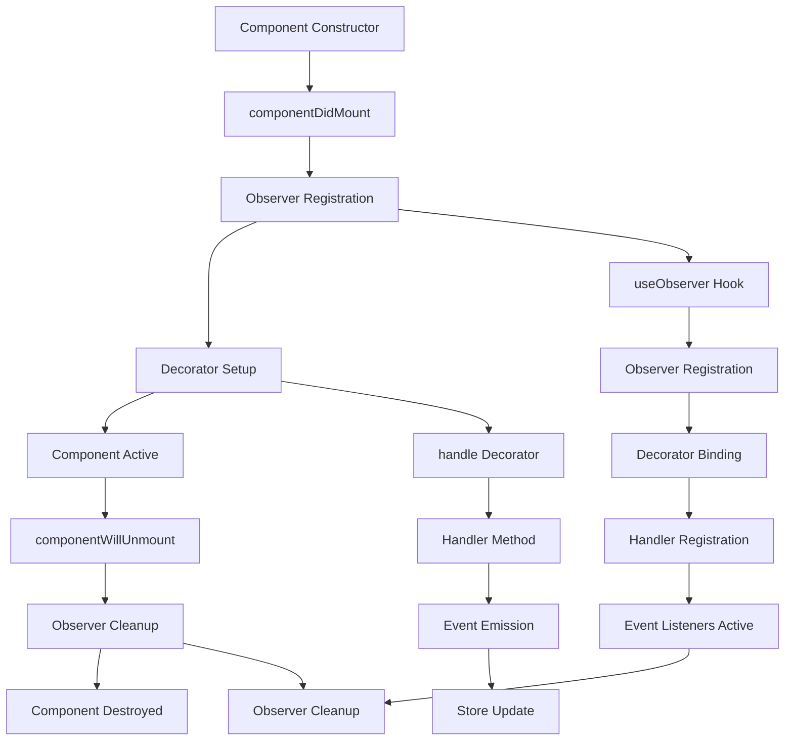

# Decorator & Observer System Lifecycle Documentation

## Table of Contents

1. [Overview](#overview)
2. [Architecture Components](#architecture-components)
3. [Component Lifecycle Flow](#component-lifecycle-flow)
4. [Decorator System](#decorator-system)
5. [Observer System](#observer-system)
6. [The Unmount Problem](#the-unmount-problem)
7. [Solutions](#solutions)
8. [Best Practices](#best-practices)
9. [Troubleshooting](#troubleshooting)

## Overview

This document explains the code flow lifecycle of components using decorators and observers in the `@sg/sg-game-client` and `@sg/sg-observer` systems. It specifically addresses why decorator handlers don't work during React component unmount and provides solutions.

## Architecture Components

### 1. React Component Layer

-   **GatewayGameBase**: Main game component extending GameBase
-   **ObserverComponent**: Base class providing observer functionality
-   **Lifecycle Methods**: componentDidMount, componentWillUnmount

### 2. Observer System (@sg/sg-observer)

-   **useObserver Hook**: Registers components with observer system
-   **Observer Container**: Manages component registrations and event bindings
-   **Decorator Processing**: Handles @handle and @render decorators

### 3. Dependency Injection (Inversify)

-   **Container**: Manages handler instances and dependencies
-   **Handler Registration**: Binds handlers to decorators
-   **Store Binding**: Connects stores to components

### 4. Gateway Connection System

-   **ConnectHandler**: Handles connection/disconnection logic
-   **GatewayConnectionStore**: Manages connection state
-   **Event System**: Emits connection events

## Component Lifecycle Flow



### Detailed Flow

#### 1. Component Mount Phase

```typescript
// 1. Component Constructor
class GatewayGameBase extends GameBase {
    constructor(props) {
        super(props);
        this.state = {
            isAuthorized: false,
            isSignedIn: false,
        };
    }
}

// 2. componentDidMount
componentDidMount() {
    // Observer registration happens here
    const dispose = useObserver(this, namespace);
    this.setState({ dispose });
}
```

#### 2. Observer Registration Phase

```typescript
// useObserver hook (from @sg/sg-observer)
function useObserver(component, namespace) {
    // 1. Get observer container
    const container = Observer.getContainer(namespace);

    // 2. Register component with observer
    const observer = container.register(component);

    // 3. Set up decorator bindings
    setupDecorators(component, observer);

    // 4. Return cleanup function
    return () => observer.dispose();
}
```

#### 3. Decorator Setup Phase

```typescript
// @handle decorator processing
@handle(gc.GatewayConnection.GatewayConnectionHandlers.ConnectHandler, (handler) => handler.disconnect())
terminateGatewayConnection() {
    console.log('terminate Gateway Connection');
}

// Decorator setup process:
// 1. Extract handler class from decorator
// 2. Get handler instance from DI container
// 3. Bind method call to event system
// 4. Register event listener
```

#### 4. Component Active Phase

```typescript
// During component lifecycle:
// - Decorators are active
// - Event listeners are registered
// - Handler methods can be called
// - Store updates trigger re-renders
```

#### 5. Component Unmount Phase

```typescript
// componentWillUnmount
componentWillUnmount() {
    // 1. Call parent cleanup
    super.componentWillUnmount();

    // 2. Call terminate method
    this.terminateGatewayConnection(); // ❌ DECORATOR MAY NOT WORK HERE
}

// Observer cleanup
componentWillUnmount() {
    const { dispose } = this.state;
    if (dispose) {
        dispose(); // This cleans up the observer system
    }
}
```

## Decorator System

### @handle Decorator

```typescript
@handle(gc.GatewayConnection.GatewayConnectionHandlers.ConnectHandler, (handler) => handler.disconnect())
terminateGatewayConnection() {
    console.log('terminate Gateway Connection');
}
```

**How it works:**

1. **Handler Resolution**: Gets handler instance from DI container
2. **Method Binding**: Binds the decorated method to handler method
3. **Event Registration**: Registers event listener for method calls
4. **Execution**: When method is called, handler method is executed

### @render Decorator

```typescript
@render(gc.GatewayConnection.GatewayConnectionStore, (store) => store.isConnected)
handleConnectLiveGatewayForGame(isConnected: boolean): void {
    if (isConnected) this.connectLiveGateway();
}
```

**How it works:**

1. **Store Observation**: Observes store for changes
2. **Value Extraction**: Extracts specific value from store
3. **Method Call**: Calls decorated method when value changes
4. **Re-render**: Triggers component re-render

## Observer System

### Observer Registration

```typescript
// In ObserverComponent
componentDidMount(): void {
    const { namespace } = this.props;

    if (!namespace) {
        return;
    }

    try {
        const dispose = useObserver(this, namespace);
        if (!dispose) {
            throw new Error('Observer registration failed');
        }
        this.setState({ dispose });
    } catch (error) {
        // Retry logic
    }
}
```

### Observer Cleanup

```typescript
componentWillUnmount(): void {
    const { dispose } = this.state;
    if (dispose) {
        try {
            dispose(); // Cleans up observer system
        } catch (error) {
            // Silent fail on cleanup
        }
    }
}
```

## The Unmount Problem

### Problem Description

When a React component unmounts, the decorator system becomes inactive before the component's `componentWillUnmount` method can execute decorator-bound methods.

### Root Causes

#### 1. Observer Cleanup Timing

```typescript
componentWillUnmount() {
    // 1. Observer cleanup happens first
    const { dispose } = this.state;
    if (dispose) {
        dispose(); // ❌ Observer system is now inactive
    }

    // 2. Decorator call happens after
    this.terminateGatewayConnection(); // ❌ No observer to handle this
}
```

#### 2. Event System State

```typescript
// When observer.dispose() is called:
function dispose() {
    // 1. Remove all event listeners
    this.eventListeners.clear();

    // 2. Unregister from container
    this.container.unregister(this);

    // 3. Clean up decorator bindings
    this.decoratorBindings.clear();

    // 4. Observer is now inactive
}
```

#### 3. Handler Injection Dependency

```typescript
// The handler depends on the DI container
@handle(gc.GatewayConnection.GatewayConnectionHandlers.ConnectHandler, (handler) => handler.disconnect())

// When container is cleaned up:
// - Handler instances are destroyed
// - Injection context is lost
// - Decorator can't resolve handler
```

### Symptoms

-   "GatewayConnectionHandlers disconnect" message doesn't appear
-   Connection cleanup doesn't execute properly
-   Memory leaks from uncleaned connections
-   Inconsistent behavior during component destruction

## Solutions

### Solution 1: Call Disconnect Before Observer Cleanup

```typescript
componentWillUnmount() {
    // 1. Disconnect first (while observer is active)
    this.terminateGatewayConnection();

    // 2. Then cleanup observer
    const { dispose } = this.state;
    if (dispose) {
        dispose();
    }

    // 3. Call parent cleanup
    super.componentWillUnmount();
}
```

**Pros:**

-   Simple implementation
-   Uses existing decorator system
-   Minimal code changes

**Cons:**

-   Still depends on observer timing
-   May not work in all scenarios

### Solution 2: Use Direct Handler Access

```typescript
componentWillUnmount() {
    // Direct handler access (bypasses decorator)
    const handler = sharedContainer.get(gc.GatewayConnection.GatewayConnectionHandlers.ConnectHandler);
    if (handler) {
        handler.disconnect();
    }

    // Then cleanup
    const { dispose } = this.state;
    if (dispose) {
        dispose();
    }
}
```

**Pros:**

-   Bypasses decorator system entirely
-   Guaranteed to work
-   Direct control over handler

**Cons:**

-   Bypasses intended architecture
-   Less maintainable
-   Harder to test

### Solution 3: Singleton Manager (Recommended)

```typescript
// Centralized connection management
class GatewayConnectionManager {
    private static instance: GatewayConnectionManager;

    static getInstance(): GatewayConnectionManager {
        if (!GatewayConnectionManager.instance) {
            GatewayConnectionManager.instance = new GatewayConnectionManager();
        }
        return GatewayConnectionManager.instance;
    }

    disconnect(reason?: string): void {
        // Direct disconnect without decorator dependency
        const handler = sharedContainer.get(gc.GatewayConnection.GatewayConnectionHandlers.ConnectHandler);
        if (handler) {
            handler.disconnect();
        }
    }
}

// Usage
componentWillUnmount() {
    GatewayConnectionManager.getInstance().disconnect('component_unmount');

    const { dispose } = this.state;
    if (dispose) {
        dispose();
    }
}
```

**Pros:**

-   Centralized control
-   Independent of component lifecycle
-   Easy to use from anywhere
-   Better error handling
-   Testable

**Cons:**

-   Additional complexity
-   Requires new infrastructure

## Best Practices

### 1. Connection Management

```typescript
// ✅ Good: Use singleton manager
class ConnectionManager {
    static disconnect(reason: string) {
        // Centralized disconnect logic
    }
}

// ❌ Bad: Rely on decorators for cleanup
componentWillUnmount() {
    this.terminateGatewayConnection(); // May not work
}
```

### 2. Error Handling

```typescript
// ✅ Good: Handle cleanup errors gracefully
componentWillUnmount() {
    try {
        ConnectionManager.disconnect('unmount');
    } catch (error) {
        console.error('Cleanup failed:', error);
    }

    const { dispose } = this.state;
    if (dispose) {
        try {
            dispose();
        } catch (error) {
            console.error('Observer cleanup failed:', error);
        }
    }
}
```

### 3. Testing

```typescript
// ✅ Good: Test cleanup logic
describe('Component Cleanup', () => {
    it('should disconnect on unmount', () => {
        const disconnectSpy = jest.spyOn(ConnectionManager, 'disconnect');

        const component = mount(<MyComponent />);
        component.unmount();

        expect(disconnectSpy).toHaveBeenCalledWith('unmount');
    });
});
```

## Troubleshooting

### Common Issues

#### Issue 1: Decorator not working on unmount

**Symptoms:** No "GatewayConnectionHandlers disconnect" message
**Cause:** Observer system cleaned up before decorator execution
**Solution:** Use direct handler access or singleton manager

#### Issue 2: Connection not disconnecting

**Symptoms:** WebSocket connection remains active
**Cause:** Disconnect method not called or failed
**Solution:** Add error handling and logging

#### Issue 3: Memory leaks

**Symptoms:** Increasing memory usage
**Cause:** Observers or event listeners not cleaned up
**Solution:** Ensure dispose() is called in componentWillUnmount

### Debug Steps

1. **Add Logging**

```typescript
componentWillUnmount() {
    console.log('Component unmounting...');

    try {
        this.terminateGatewayConnection();
        console.log('Disconnect called successfully');
    } catch (error) {
        console.error('Disconnect failed:', error);
    }

    const { dispose } = this.state;
    if (dispose) {
        try {
            dispose();
            console.log('Observer cleanup successful');
        } catch (error) {
            console.error('Observer cleanup failed:', error);
        }
    }
}
```

2. **Check Observer State**

```typescript
// Add to component to check observer state
componentDidMount() {
    console.log('Observer state:', this.state.dispose ? 'Active' : 'Inactive');
}
```

3. **Verify Handler Registration**

```typescript
// Check if handler is available
const handler = sharedContainer.get(gc.GatewayConnection.GatewayConnectionHandlers.ConnectHandler);
console.log('Handler available:', !!handler);
```

### Performance Considerations

1. **Observer Cleanup**: Always call dispose() to prevent memory leaks
2. **Event Listeners**: Remove all listeners during cleanup
3. **Handler Instances**: Don't hold references to handlers after cleanup
4. **Timing**: Call disconnect methods before observer cleanup

## Conclusion

The decorator and observer system provides powerful functionality for reactive components, but has limitations during component unmount. The recommended solution is to use a singleton manager for connection management, ensuring reliable cleanup independent of the component lifecycle.

Key takeaways:

-   Observer cleanup happens before decorator execution
-   Use singleton managers for critical cleanup operations
-   Always handle cleanup errors gracefully
-   Test cleanup logic thoroughly
-   Monitor for memory leaks

This approach ensures reliable connection management while maintaining the benefits of the decorator system during component lifecycle.
