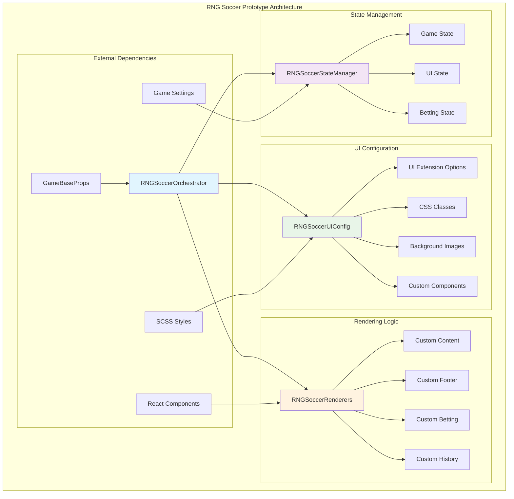
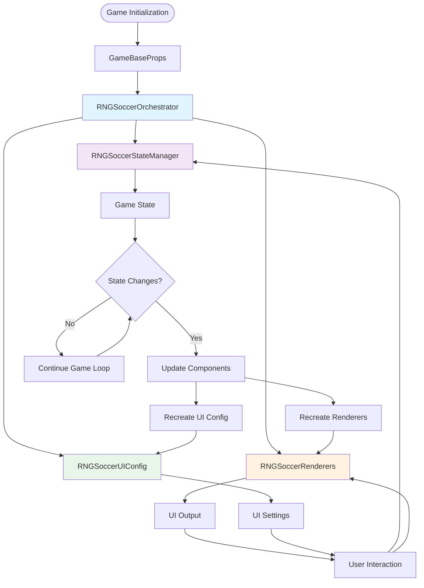
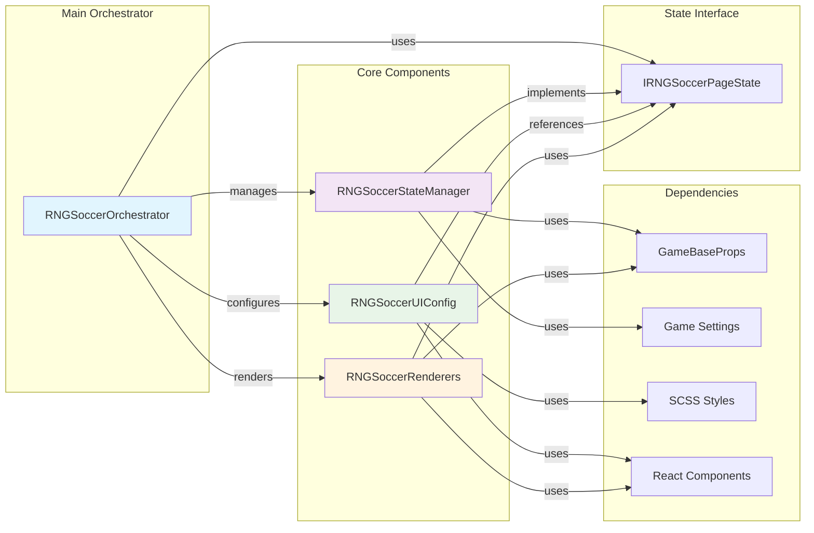
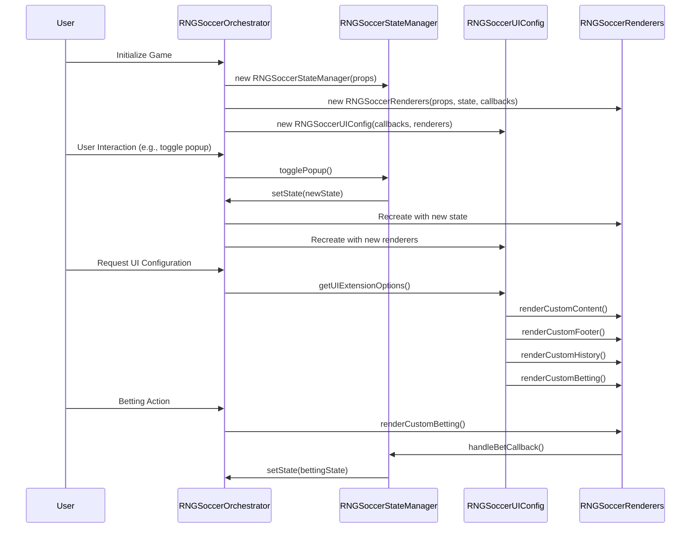
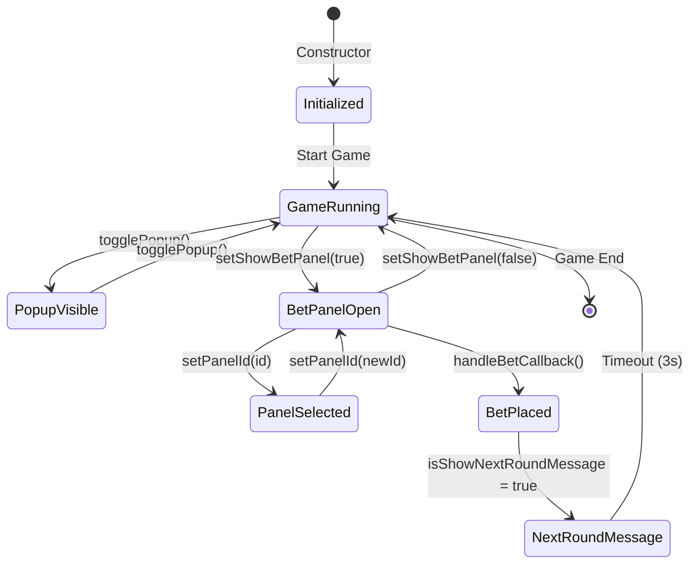

# RNG Soccer Prototype Components

This directory contains separated components that were extracted from the original `RNGSoccerPage` class to improve code organization and maintainability. These components have been cleaned of external dependencies on `@sg/sg-game-client` and `@sg/sg-observer` to make them more portable and testable.

## Architecture Diagrams

### 1. Component Structure Diagram



### 2. Data Flow Diagram



### 3. Component Relationships Diagram



### 4. Method Call Flow Diagram



### 5. State Management Flow



## Components Overview

### 1. `RNGSoccerStateManager` (`rng-soccer-state-manager.tsx`)

**Responsibility**: Manages all state-related logic and operations

-   Initializes game state with default values
-   Handles state updates for popup visibility, betting panel, and panel IDs
-   Manages betting callbacks and timeout logic
-   Configures game container on initialization

**Key Methods**:

-   `togglePopup()` - Toggles popup visibility
-   `setShowBetPanel()` - Controls betting panel visibility
-   `setPanelId()` - Sets active panel ID
-   `resetBettingPanel()` - Resets betting panel state
-   `handleBetCallback()` - Handles bet completion logic

### 2. `RNGSoccerUIConfig` (`rng-soccer-ui-config.tsx`)

**Responsibility**: Manages UI configuration and styling

-   Provides UI extension options for the game renderer
-   Manages CSS classes and styling configurations
-   Handles background image configurations
-   Configures custom component renderers

**Key Methods**:

-   `getUIExtensionOptions()` - Returns UI configuration object
-   `getGameBackgroundImage()` - Returns game background image
-   `getDisconnectViewBackground()` - Returns disconnect view background

### 3. `RNGSoccerRenderers` (`rng-soccer-renderers.tsx`)

**Responsibility**: Handles all custom rendering logic

-   Renders custom content (settlement results)
-   Renders custom footer with betting options
-   Renders custom betting interface
-   Renders custom history/statistics

**Key Methods**:

-   `renderCustomContent()` - Renders main game content
-   `renderCustomFooter()` - Renders footer section
-   `renderCustomBetting()` - Renders betting interface
-   `renderCustomHistory()` - Renders statistics/history

### 4. `RNGSoccerEventHandlers` (`rng-soccer-event-handlers.tsx`)

**Responsibility**: Manages game lifecycle events

-   Handles connection events
-   Manages game state transitions
-   Processes game-specific events

**Key Methods**:

-   `closeConnect()` - Handles connection closure

### 5. `RNGSoccerOrchestrator` (`rng-soccer-orchestrator.tsx`)

**Responsibility**: Main orchestrator that combines all components

-   Initializes and coordinates all separated components
-   Manages state and component lifecycle
-   Delegates operations to appropriate components
-   Provides public interface for accessing components

**Key Methods**:

-   `setState()` - Updates internal state and triggers component updates
-   `getState()` - Returns current state
-   `getRenderers()` - Returns renderers component
-   `getUIConfig()` - Returns UI configuration component
-   `getEventHandlers()` - Returns event handlers component

## Usage

### Basic Usage

```typescript
import { RNGSoccerOrchestrator } from './prototype';

// Create orchestrator instance
const orchestrator = new RNGSoccerOrchestrator(props);

// Access components
const renderers = orchestrator.getRenderers();
const uiConfig = orchestrator.getUIConfig();
const eventHandlers = orchestrator.getEventHandlers();

// Use components
const content = renderers.renderCustomContent();
const background = uiConfig.getGameBackgroundImage();
```

### Individual Component Usage

```typescript
import { RNGSoccerStateManager, RNGSoccerUIConfig, RNGSoccerRenderers, RNGSoccerEventHandlers } from './prototype';

// Use individual components for specific functionality
const stateManager = new RNGSoccerStateManager(props);
const uiConfig = new RNGSoccerUIConfig(/* dependencies */);
const renderers = new RNGSoccerRenderers(/* dependencies */);
const eventHandlers = new RNGSoccerEventHandlers();
```

## Benefits of Separation

1. **Single Responsibility**: Each component has a clear, focused responsibility
2. **Testability**: Individual components can be tested in isolation
3. **Maintainability**: Changes to specific functionality are localized
4. **Reusability**: Components can be reused in different contexts
5. **Readability**: Code is easier to understand and navigate
6. **Portability**: Components are free from external framework dependencies
7. **Independence**: No inheritance dependencies, pure composition

## Architecture Pattern

This separation follows the **Composition Pattern** where:

-   Each component handles a specific aspect of the original class
-   The orchestrator combines all components to recreate the original functionality
-   Dependencies are injected through constructors
-   State management is centralized in the state manager
-   UI logic is separated from business logic
-   No inheritance, pure composition for better flexibility

## Dependencies Removed

The following external dependencies have been removed from the prototype components:

-   `@sg/sg-game-client` - Game client framework
-   `@sg/sg-observer` - Observer pattern framework
-   `GatewayGameBase` - Base class inheritance
-   Decorators like `@observer` and `@handle`

This makes the components more portable and easier to test in isolation.

## Migration Notes

-   The `RNGSoccerOrchestrator` is now a standalone class, not extending any base class
-   All original functionality is preserved through composition
-   No new business logic was added during separation
-   All components maintain the same console logging for debugging
-   Components are now framework-agnostic and can be used in different contexts
-   State management is handled internally by the orchestrator
