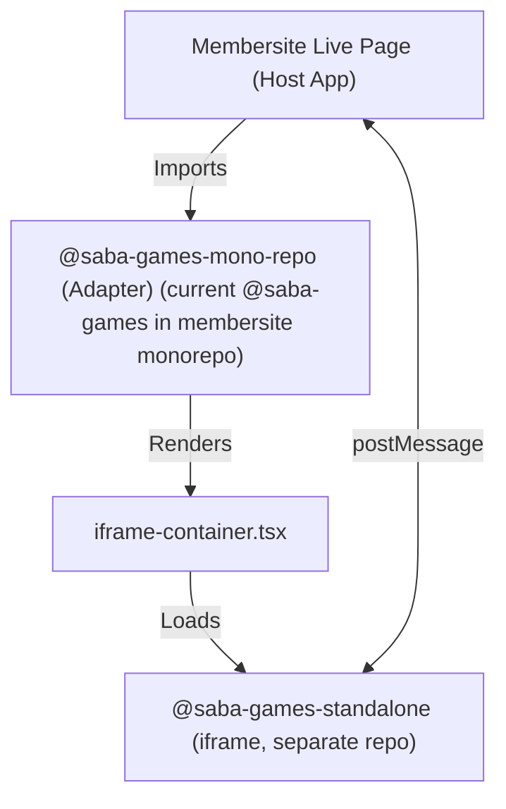
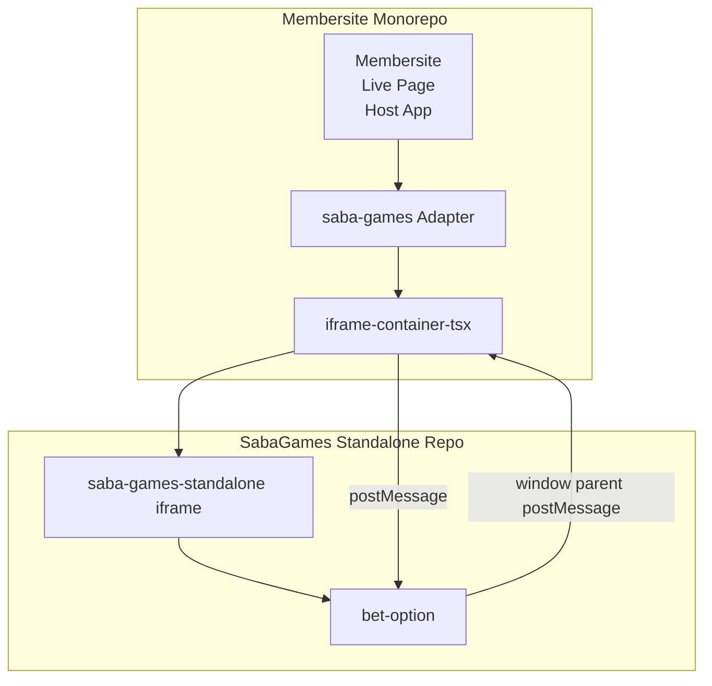

# Saba Games Live Page Iframe Architecture

## Overview Diagram

This diagram provides a high-level overview of the architecture, showing the relationship between the Membersite Live Page (host app), the @saba-games-mono-repo (Adapter), the iframe container, and the standalone client (@saba-games-standalone).



## Overview

The Saba Games project is split across two repositories:

-   **@saba-games-standalone** (Separate Repository): A standalone, self-contained game client hosted on its own domain. It exposes the full game UI and logic, designed to be embedded via an iframe. Repository URL: https://git3.nexdev.net/l1/game-clients/standalone-saba-games-live-page
-   **@saba-games-mono-repo (Adapter)** (This Repository): The current `@saba-games` in the membersite monorepo, now serves as an adapter package that loads the standalone client in an iframe and provides additional integration components and logic for the Membersite Live Page.

This separation allows for independent development, deployment, and versioning, as well as easier integration with multiple host platforms.

## What is the Adapter?

The **@saba-games-mono-repo (Adapter)** acts as a bridge between the Membersite Live Page and the standalone game client. Its responsibilities include:

-   Providing React components (such as `iframe-container.tsx`) to embed the standalone client via iframe.
-   Managing communication between the host and the iframe using `postMessage`.
-   Handling integration logic, overlays, and UI state that connect the Membersite Live Page to the game client.
-   Abstracting away cross-domain messaging and providing a clean API for the host app.

## Detailed Architecture

### @saba-games-mono-repo (Adapter, This Repository)

-   **Purpose:** Provides React components and utilities to embed and interact with the standalone client.
-   **Key Component:** `iframe-container.tsx` – loads the standalone client in an iframe and manages communication.
-   **Hooks:** `use-iframe-height`, `use-betting-panel` – handle message types and manage related state/UI.
-   **Portals:** `BettingPanelPortal`, `ConfirmBetPortal` – overlays/dialogs in response to messages.
-   **Configuration:** Allows the host to specify the URL of the standalone client.

### @saba-games-standalone (Separate Repository)

-   **Purpose:** Contains the full game client, including all UI, business logic, and assets.
-   **Deployment:** Built and deployed to a dedicated domain (e.g., `https://games.example.com`).
-   **Usage:** Not imported as a library; loaded via an iframe by host applications.
-   **Communication:** Uses `window.parent.postMessage` to send messages to the host; listens for messages from the host.

## Communication Flow Diagram

The following diagram illustrates the essential communication between the Membersite monorepo (host, adapter) and the saba-games-standalone repository (iframe), grouping components by repository and clearly showing the adapter's role.



**Flow Description:**

-   User actions in the iframe (bet-option) send messages to the Membersite Live Page using `window.parent.postMessage`.
-   The Membersite Live Page (via the adapter and iframe-container) can send messages back to the iframe using `postMessage`, which are handled by listeners inside the iframe.

## Communication Protocol

-   **Events:** Define a set of message types for communication (e.g., `USER_LOGIN`, `BET_PLACED`, `GAME_RESULT`).

| Type             | Direction     | Payload Example                   | Description              |
| ---------------- | ------------- | --------------------------------- | ------------------------ |
| USER_LOGIN       | host → iframe | `{ userId: 'abc', token: '...' }` | Pass user info to iframe |
| BET_PLACED       | iframe → host | `{ amount: 100, choice: 'A' }`    | User placed a bet        |
| SHOW_CONFIRM_BET | host → iframe | `{ betId: 123, amount: 100 }`     | Show confirm bet dialog  |
| BET_RESULT       | host → iframe | `{ betId: 123, result: 'win' }`   | Notify result of a bet   |
| IFRAME_READY     | iframe → host | `{}`                              | Iframe loaded and ready  |

-   **Example: Sending a message from iframe to host:**
    ```js
    // Inside the iframe (standalone)
    const message = { type: 'BET_PLACED', payload: { amount: 100, choice: 'A' } };
    window.parent.postMessage(message, '*');
    ```
-   **Example: Receiving a message from host in iframe:**
    ```js
    // Inside the iframe (standalone)
    window.addEventListener('message', (event) => {
        if (event.origin !== 'https://expected-host.com') return;
        const { type, payload } = event.data;
        if (type === 'SHOW_CONFIRM_BET') {
            // Show confirm bet dialog
        }
    });
    ```
-   **Security:**
    -   Always validate the origin of incoming messages using `event.origin`.
    -   Never trust data from the parent window without validation and sanitization.
-   **Extensibility:**
    -   New message types can be added as needed for future features.
    -   Use a version field in messages if protocol changes are expected.
-   **Error Handling:**
    -   Log unexpected or malformed messages for easier debugging.
    -   Fail gracefully if required data is missing or invalid.
-   **Versioning:**
    -   Ensure both host and standalone client agree on the protocol version if changes are made.

## Development & Testing

-   Develop each repository independently.
-   Mock the iframe or messaging bridge for local development and testing.
-   Test integration points using end-to-end tests or integration test suites.
-   Document the deployment URL and version of the standalone client used by the adapter.

## Best Practices

-   Keep the standalone client agnostic of the host environment.
-   Use dependency injection and mocking for all integration points.
-   Document all public events and APIs for cross-domain communication.
-   Version and deploy each package independently.
-   Maintain clear documentation in both repositories about integration points and communication contracts.

## Suggested Improvements

-   Automate deployment and versioning for both repositories.
-   Document all message types and expected payloads.
-   Add integration tests to verify iframe communication.
-   Provide example host apps for reference.
-   Synchronize protocol changes between repositories.
