# ConnectionManager Architectural Diagrams

## Table of Contents

1. [Class Diagram](#class-diagram)
2. [Sequence Diagrams](#sequence-diagrams)
3. [State Machine Diagram](#state-machine-diagram)
4. [Component Integration Diagram](#component-integration-diagram)
5. [Connection Lifecycle Flow](#connection-lifecycle-flow)
6. [Shutdown Process Flow](#shutdown-process-flow)

## Class Diagram

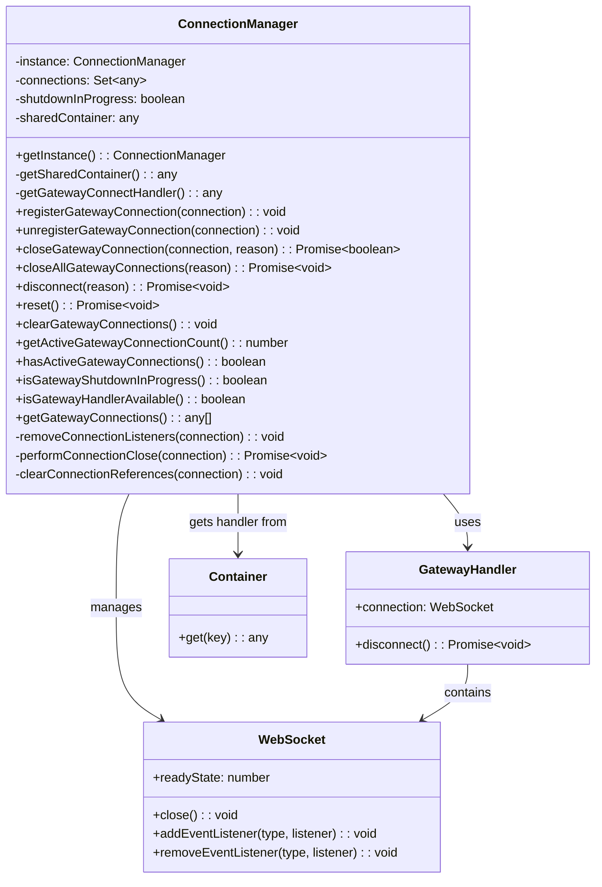

## Sequence Diagrams

### 1. Connection Registration Flow

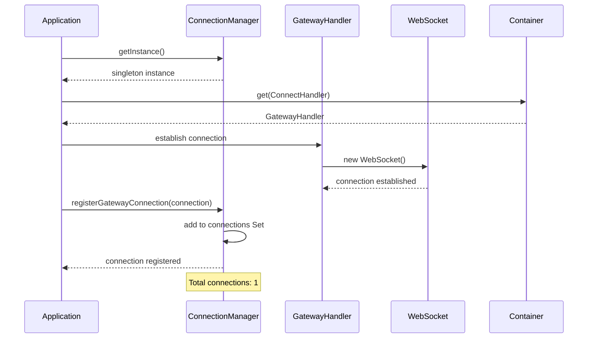

### 2. Connection Cleanup Flow

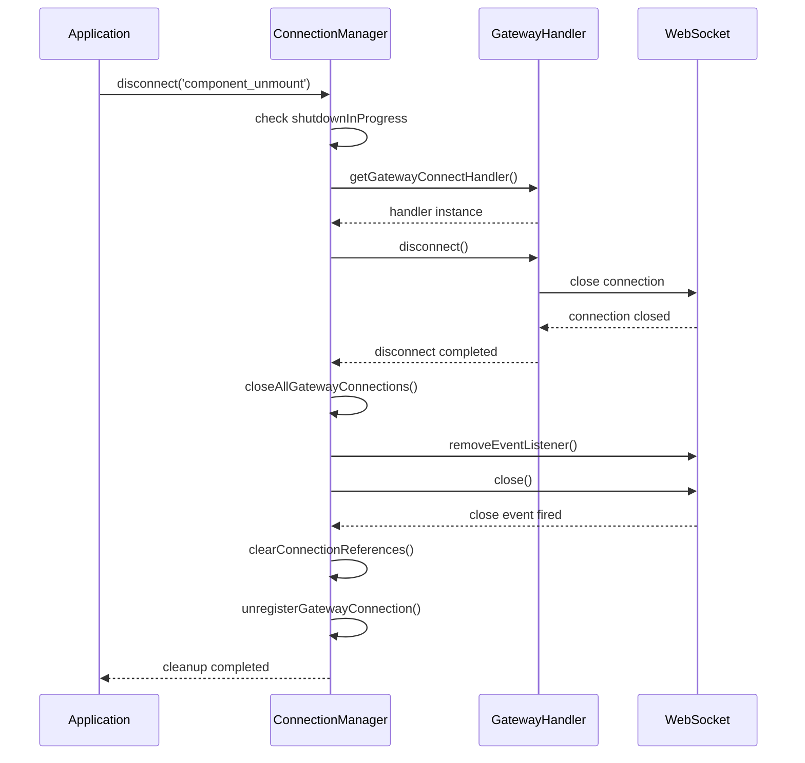

### 3. Container Integration Flow

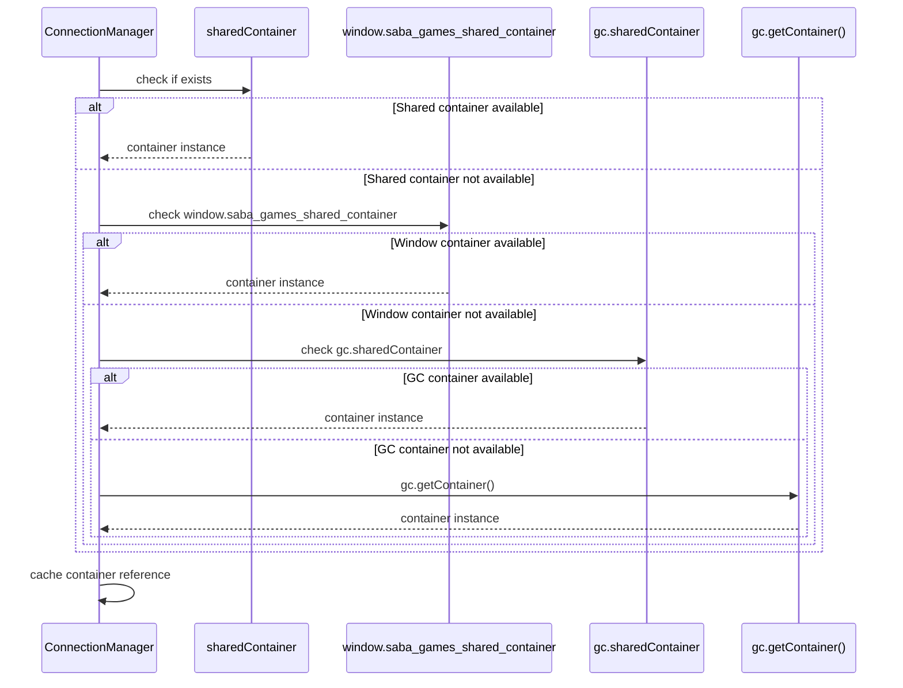

## State Machine Diagram

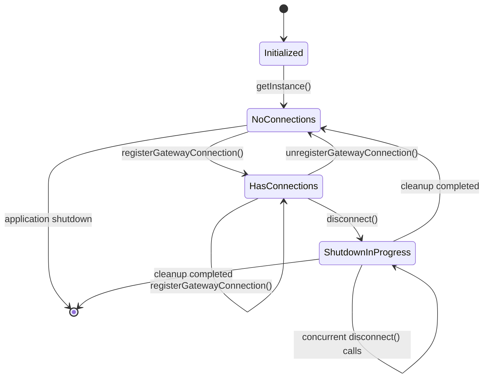

## Component Integration Diagram

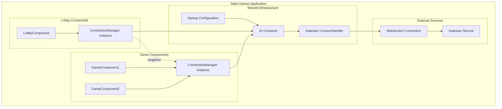

## Connection Lifecycle Flow

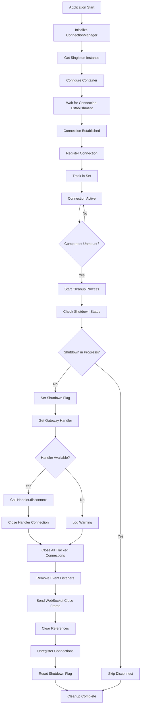

## Shutdown Process Flow

```mermaid
flowchart TD
    A[Shutdown Request] --> B{Shutdown Already in Progress?}
    B -->|Yes| C[Skip - Log Message]
    B -->|No| D[Set shutdownInProgress = true]

    D --> E[Get Gateway ConnectHandler]
    E --> F{Handler Found?}
    F -->|No| G[Log Warning]
    F -->|Yes| H{Handler.disconnect is Function?}

    H -->|No| I[Log Warning]
    H -->|Yes| J[Call handler.disconnect()]

    J --> K[Handler Disconnect Complete]
    K --> L{Handler has Connection?}
    L -->|Yes| M[Close Handler Connection]
    L -->|No| N[Log Info]

    M --> O[Close All Tracked Connections]
    N --> O

    O --> P[Remove Event Listeners]
    P --> Q[Send WebSocket Close Frames]
    Q --> R[Clear Connection References]
    R --> S[Unregister from Tracking]
    S --> T[Set shutdownInProgress = false]
    T --> U[Shutdown Complete]

    G --> O
    I --> O
    C --> V[End Process]
    U --> V
```

## Memory Management Flow

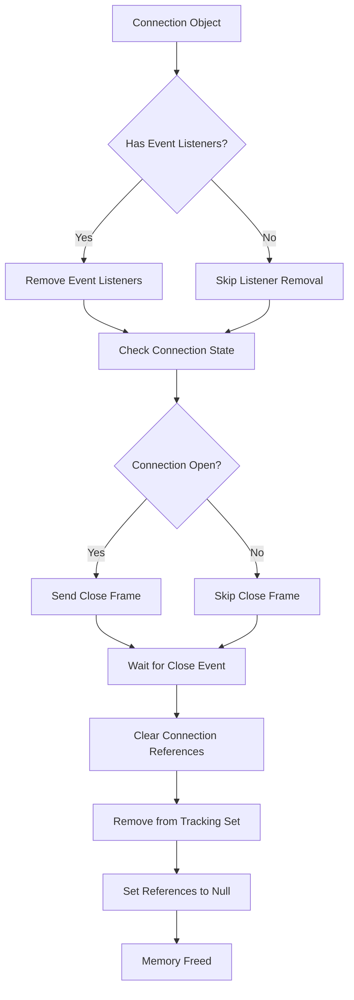

## Error Handling Flow

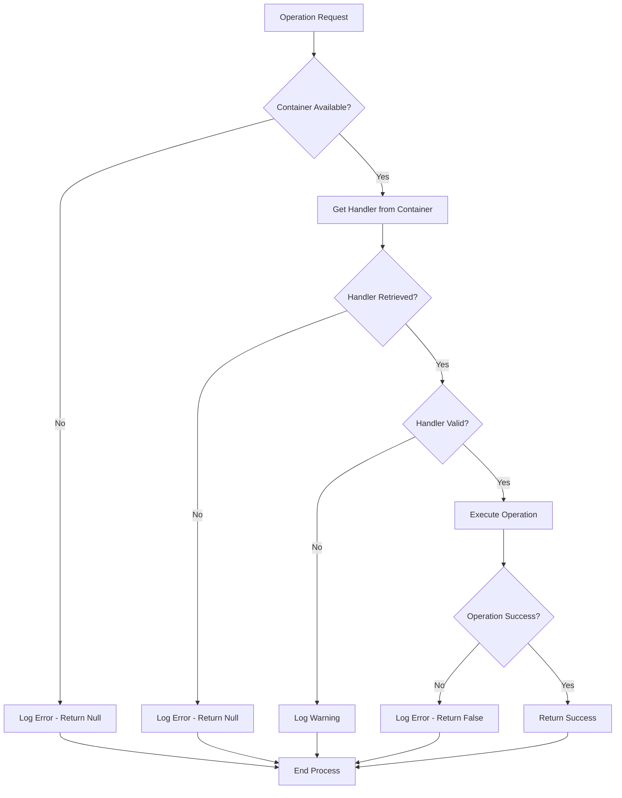

## Performance Monitoring Points

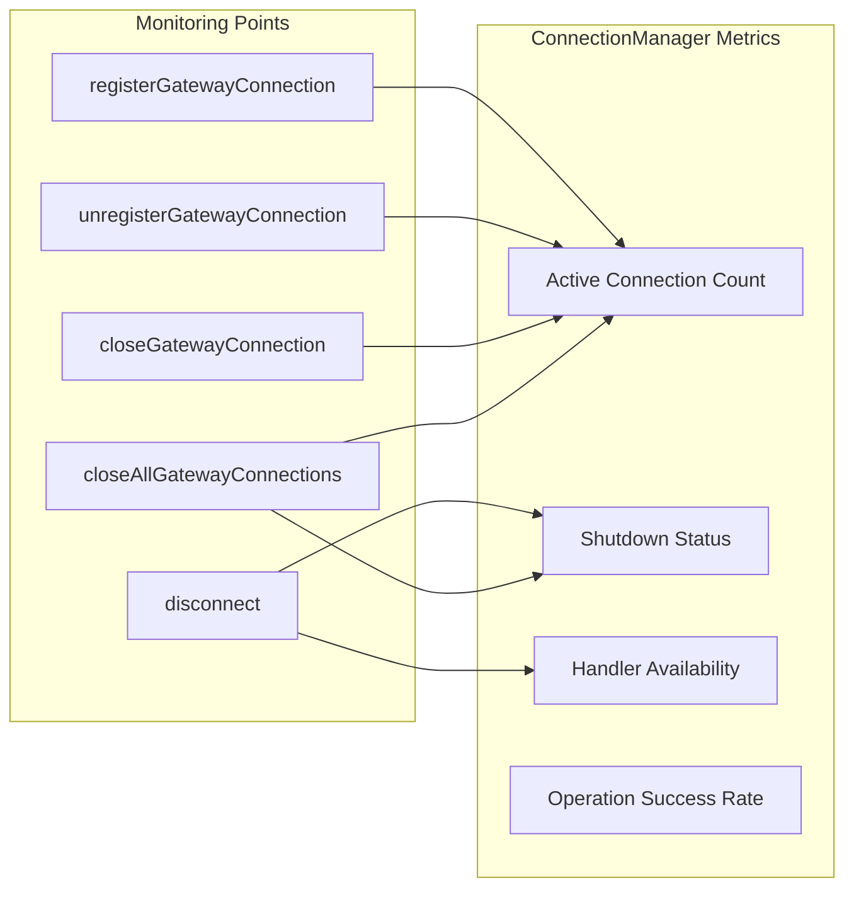

## Integration with React Lifecycle

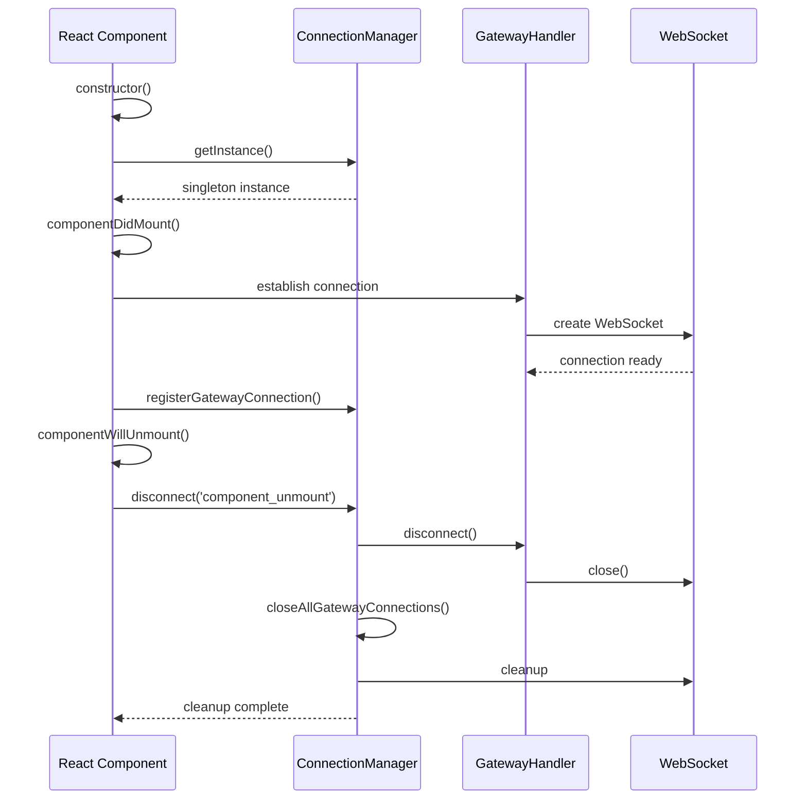

## Container Source Priority

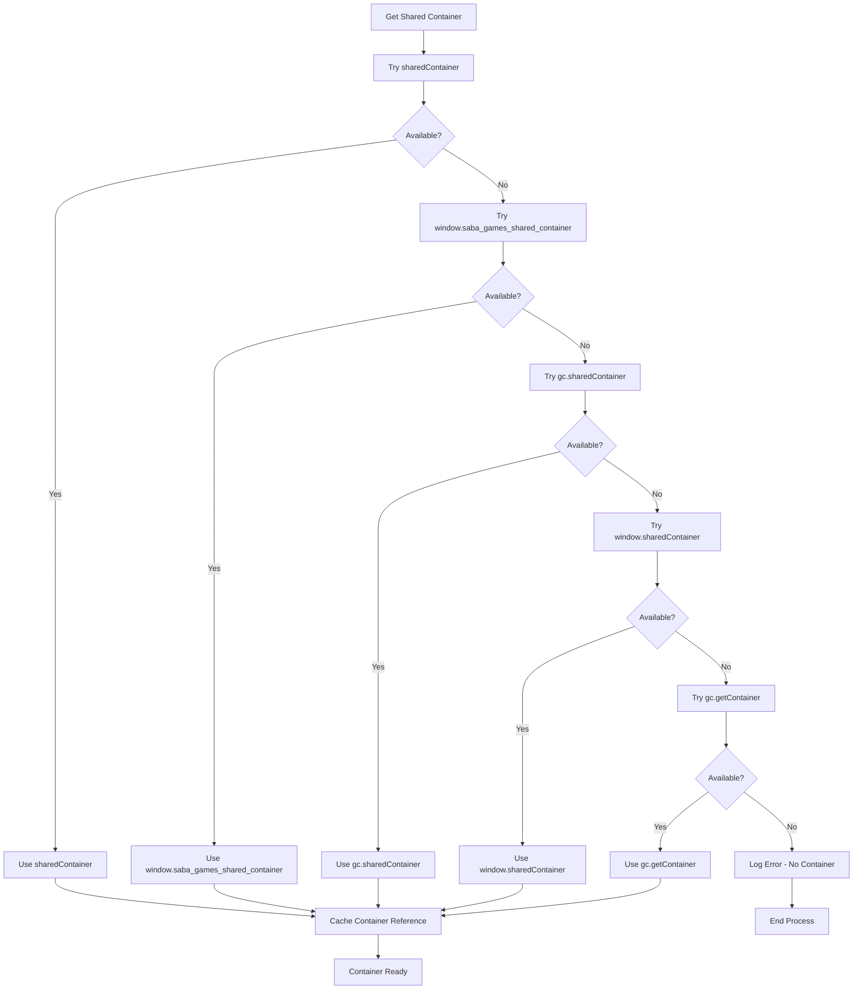

These diagrams provide a comprehensive visual representation of the ConnectionManager's architecture, behavior, and integration patterns. They help developers understand:

1. **Class Structure**: How the ConnectionManager is organized internally
2. **Interaction Patterns**: How components interact with the ConnectionManager
3. **Lifecycle Management**: The complete flow of connection handling
4. **Error Handling**: How errors are managed throughout the process
5. **Integration Points**: How the ConnectionManager fits into the larger application architecture

Use these diagrams alongside the detailed documentation to implement and maintain ConnectionManager effectively in your Saba Games application.
